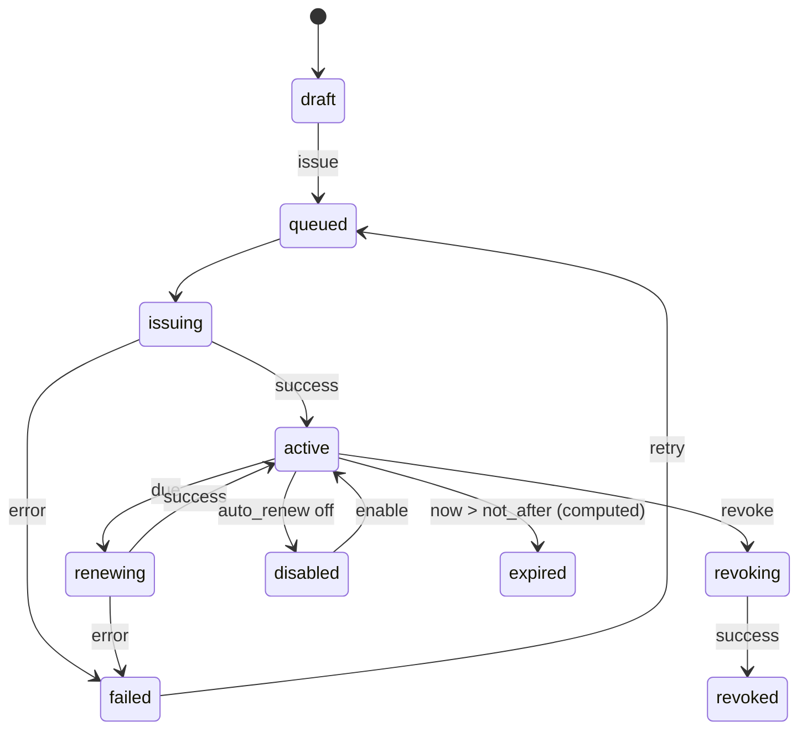

# KPCCSSL 工程实施文件

> **本文件是实施主文档（source of truth）。**  
> 方案背景、取舍论证和风险分析见 [`docs/architecture.md`](docs/architecture.md)。  
> 使用方式：按 Phase 顺序执行；每完成一项勾选；每阶段结束必须通过该阶段验收，再进入下一阶段。  
> 遇到与本文冲突的实际情况，先更新本文和 ADR，再改代码。

---

## 0. 项目信息

| 项 | 内容 |
|---|---|
| 项目名 | KPCCSSL |
| 定位 | 自托管 Web 证书签发/续期/部署工具 |
| 技术栈 | Go + React SPA + SQLite + acme.sh |
| 交付形态 | 单二进制 / Docker 镜像（前端静态嵌入） |
| 许可证 | MIT；运行时依赖 acme.sh（GPLv3） |
| 当前阶段 | MVP 实现完成（Phase 0–4），真实 CA/DNS PoC 与生产加固待验证 |
| 默认验证方式 | DNS-01（API 自动添加 TXT） |
| 默认部署形态 | 单机 Docker，单写者，不做多副本 |

### 0.1 目标

- 用 Web UI 管理 ACME 账户、DNS 凭据、证书和续期。
- 支持 DNS-01、HTTP-01、TLS-ALPN-01；泛域名必须 DNS-01。
- 自动续期、失败重试、通知、审计、可观测。
- 私钥和 DNS 凭据加密存储；不暴露任意 shell。
- 单容器可运行，数据可备份、可恢复、可升级。

### 0.2 非目标（本期不做）

- 公共 SaaS、多租户计费。
- 内部 PKI / 私有 CA 签发体系。
- 多副本高可用（同一 acme home 不支持并发多写）。
- 任意 shell hook / 插件市场。
- 自研 ACME 协议实现。

### 0.3 关键约束

1. acme.sh 是外部 CLI，不修改上游源码。
2. 同一 `acme home` 同时只允许一个 acme.sh 进程。
3. 用户输入不得进入 shell；所有外部命令使用 argv。
4. `--reloadcmd`、`--pre-hook`、`--post-hook` 不对 Web 用户开放。
5. acme.sh 版本固定，禁用自动升级。
6. 私钥、DNS 凭据、EAB、SMTP 密码等必须加密存储。
7. 数据库存“期望配置”，acme.sh 文件存“实际签发结果”，启动时对账。

---

## 1. 架构决策（ADR 摘要）

| ID | 决策 | 理由 | 备注 |
|---|---|---|---|
| D-001 | 使用 acme.sh 子进程，而不是 lego/自研 | 约 200 个 DNS provider 脚本，成熟 | 抽象 `Engine` 接口，未来可加 lego |
| D-002 | Go 单二进制 + React 静态嵌入 | 部署简单，版本一致 | 开发期 Vite 代理 |
| D-003 | SQLite（WAL） | 单机规模足够，备份简单 | 纯 Go 驱动 `modernc.org/sqlite` |
| D-004 | 每任务临时 `--accountconf` | 避免 DNS 凭据写入主配置 | 必须先做 PoC |
| D-005 | 全局串行执行 acme.sh | 无内置进程锁，共享 account/ca 状态 | 多进程用 `flock` |
| D-006 | DNS-01 作为默认 | 不依赖入站 80/443，支持泛域名 | HTTP-01 作为 v1 |
| D-007 | 不暴露自由 shell hook | 防止 Web 漏洞升级为 RCE | 结构化部署目标 |
| D-008 | 固定 acme.sh 版本 | 输出/参数可能变化 | 升级走镜像 + 契约测试 |
| D-009 | 单写者，不做多副本 | acme.sh 状态在文件系统 | 扩展走 Agent/分片 |
| D-010 | MIT + GPLv3 依赖 | 调用独立进程 | 分发镜像附源码/声明 |

---

## 2. 技术基线

### 2.1 后端

| 组件 | 选择 | 版本策略 |
|---|---|---|
| Go | 1.24+ | CI 固定次新稳定版 |
| HTTP | `net/http` + `chi` | 锁定 minor |
| DB | SQLite + `modernc.org/sqlite` | 锁定 minor |
| SQL | 手写 SQL（集中于 `internal/store`）+ `goose` | 见 ADR-007；迁移文件入库 |
| 密码 | `golang.org/x/crypto/argon2` | 跟随 Go |
| IDN | `golang.org/x/net/idna` | 跟随 Go |
| eTLD+1 | `golang.org/x/net/publicsuffix` | 跟随 Go |
| PKCS#12 | `software.sslmate.com/src/go-pkcs12` | 锁定 minor |
| 日志 | `log/slog` | 标准库 |
| 测试 | `testing` + `httptest` | 标准库 |

### 2.2 前端

| 组件 | 选择 |
|---|---|
| 框架 | React 19 + TypeScript |
| 构建 | Vite |
| 路由 | React Router |
| 服务端状态 | TanStack Query |
| 表单 | React Hook Form + Zod |
| UI | Tailwind CSS + shadcn/ui |
| 国际化 | i18next（zh-CN 默认，en） |
| 测试 | Vitest + Testing Library + Playwright |
| API 类型 | `openapi-typescript` 生成 |

### 2.3 运行时依赖

- `bash`、`curl`、`openssl`、`socat`、`ca-certificates`、`tzdata`。
- 固定 tag 的 acme.sh，复制到 `/opt/acme.sh`（含 `dnsapi/`、`deploy/`、`notify/`）。
- 非 root 用户 `kpccssl`（UID 10001）。
- `/data` 持久卷，权限 0700。

---

## 3. 目录结构

```text
.
├── cmd/
│   └── kpccssl/
│       └── main.go              # serve / worker / migrate / doctor / admin
├── internal/
│   ├── api/                     # handlers, middleware, SSE, problem+json
│   ├── auth/                    # password, session, csrf, rbac, totp
│   ├── acme/                    # Engine interface, acme.sh executor, parser
│   │   ├── engine.go
│   │   ├── acmesh/
│   │   │   ├── executor.go
│   │   │   ├── args.go
│   │   │   ├── accountconf.go
│   │   │   ├── list.go
│   │   │   └── errors.go
│   │   └── fake/
│   ├── dnsprovider/             # provider catalog + validation
│   ├── certificate/             # domain validation, x509, state machine
│   ├── job/                     # queue, worker, retry, logs
│   ├── scheduler/               # renewal sweep
│   ├── deploy/                  # local file, reload, webhook
│   ├── notify/                  # smtp, webhook, telegram
│   ├── secret/                  # AES-GCM, master key, rotation
│   ├── store/                   # sqlc queries, migrations
│   ├── config/                  # env/flags, paths
│   └── webui/                   # embed.FS + SPA fallback
├── web/
│   ├── src/
│   │   ├── pages/
│   │   ├── components/
│   │   ├── api/
│   │   ├── i18n/
│   │   └── main.tsx
│   ├── index.html
│   └── vite.config.ts
├── docs/
│   ├── architecture.md          # 方案分析
│   └── adr/                     # 关键决策记录
├── deploy/
│   ├── Dockerfile
│   ├── docker-compose.yml
│   └── systemd/kpccssl.service
├── migrations/
├── Makefile
├── PROJECT.md                   # 本文件
└── README.md
```

**约定：**

- `internal/acme/engine.go` 只定义接口和 DTO，不依赖具体执行器。
- `internal/acme/acmesh` 是唯一允许 `exec.Command` 的地方。
- handler 不直接拼 acme.sh 参数；必须经过 `args.go`。
- 任何新增外部命令都要在 `docs/adr/` 记录原因和参数白名单。

---

## 4. 运行配置

### 4.1 环境变量

| 变量 | 默认值 | 说明 |
|---|---|---|
| `KPCC_LISTEN` | `:8080` | API/SPA 监听地址 |
| `KPCC_DATA_DIR` | `/data` | 数据根目录 |
| `KPCC_DB_PATH` | `${DATA}/kpccssl.db` | SQLite 路径 |
| `KPCC_MASTER_KEY_FILE` | `${DATA}/master.key` | 主密钥文件 |
| `KPCC_MASTER_KEY` | 空 | 直接提供主密钥（优先级低于文件） |
| `KPCC_ACME_BIN` | `/opt/acme.sh/acme.sh` | acme.sh 路径 |
| `KPCC_ACME_HOME` | `${DATA}/acme` | acme.sh 状态目录 |
| `KPCC_CERT_DIR` | `${DATA}/certs` | 证书导出目录 |
| `KPCC_LOG_DIR` | `${DATA}/logs` | 任务日志目录 |
| `KPCC_JOB_CONCURRENCY` | `1` | acme.sh 并发；默认 1，不建议改 |
| `KPCC_JOB_TIMEOUT` | `30m` | 单任务超时 |
| `KPCC_BASE_URL` | 空 | 生成绝对链接/回调时使用 |
| `KPCC_TRUSTED_PROXIES` | 空 | 信任的代理 CIDR，逗号分隔 |
| `KPCC_SETUP_TOKEN` | 自动生成 | 首次初始化 token；不设则打印到日志 |
| `KPCC_LOG_LEVEL` | `info` | debug/info/warn/error |
| `KPCC_RETENTION_DAYS` | `30` | 日志/任务保留天数 |
| `KPCC_HTTP_PORT` | `8081` | HTTP-01 standalone 端口 |
| `KPCC_TLS_PORT` | `8443` | TLS-ALPN-01 端口 |
| `KPCC_DEPLOY_ROOTS` | 空 | `local_file` 部署允许根目录，`:` 分隔 |
| `KPCC_WEBROOT_ROOTS` | `/var/www:${DATA}/webroot` | HTTP-01 webroot 允许根目录，`:` 分隔 |
| `KPCC_DEV` | `false` | 开发模式：非 Secure cookie、允许 http CA URL |
| `KPCC_FAKE_ACME` | `false` | 使用内置 fake 引擎（仅开发/E2E） |

### 4.2 数据布局

```text
/data
├── kpccssl.db
├── master.key                 # 0600，独立备份
├── acme/                      # acme.sh --home
│   ├── account.conf           # 0600，不含 SAVED_* 凭据
│   ├── ca/                    # CA 账户私钥，关键备份
│   └── <domain>[_ecc]/        # acme.sh 内部状态
├── certs/<cert-id>/
│   ├── revisions/<revision-id>/
│   └── current -> revisions/<revision-id>
├── logs/jobs/<job-id>.log
└── tmp/                       # 任务临时目录，启动清理
```

### 4.3 端口

| 用途 | 容器内 | 宿主 | 说明 |
|---|---|---|---|
| 面板/API | 8080 | 8080 | 反向代理终止 TLS |
| HTTP-01 standalone | 8081 | 80 | acme.sh `--httpport 8081` |
| TLS-ALPN standalone | 8443 | 443 | acme.sh `--tlsport 8443` |

---

## 5. 数据模型

### 5.1 状态机



**不变量：**

- 同一证书最多一个 `current_revision_id`。
- `active` 必须存在当前 revision。
- 续期/部署失败不得删除最后一次成功 revision。
- `expired` 是计算状态，不写库。
- 删除证书是软删除：停止续期、保留文件和审计；吊销是独立操作。

### 5.2 DDL（SQLite）

> 迁移文件放 `migrations/`，以下为基线 schema。ID 使用 ULID（TEXT，可排序）。

```sql
PRAGMA foreign_keys = ON;

CREATE TABLE users (
  id TEXT PRIMARY KEY,
  email TEXT NOT NULL UNIQUE,
  password_hash TEXT NOT NULL,
  totp_secret_enc TEXT,
  role TEXT NOT NULL CHECK (role IN ('admin','operator','viewer')),
  disabled INTEGER NOT NULL DEFAULT 0,
  created_at INTEGER NOT NULL,
  updated_at INTEGER NOT NULL
);

CREATE TABLE sessions (
  id TEXT PRIMARY KEY,
  user_id TEXT NOT NULL REFERENCES users(id) ON DELETE CASCADE,
  token_hash BLOB NOT NULL UNIQUE,
  csrf_secret TEXT NOT NULL,
  expires_at INTEGER NOT NULL,
  created_at INTEGER NOT NULL,
  last_seen_at INTEGER NOT NULL,
  ip TEXT,
  user_agent TEXT
);
CREATE INDEX idx_sessions_user ON sessions(user_id);
CREATE INDEX idx_sessions_expires ON sessions(expires_at);

CREATE TABLE ca_accounts (
  id TEXT PRIMARY KEY,
  name TEXT NOT NULL,
  directory_url TEXT NOT NULL,
  is_staging INTEGER NOT NULL DEFAULT 0,
  email TEXT,
  eab_kid TEXT,
  eab_hmac_enc TEXT,
  tos_accepted_at INTEGER,
  key_version INTEGER NOT NULL DEFAULT 1,
  status TEXT NOT NULL CHECK (status IN ('new','registered','error','disabled')),
  last_error TEXT,
  created_at INTEGER NOT NULL,
  updated_at INTEGER NOT NULL
);
CREATE INDEX idx_ca_directory ON ca_accounts(directory_url);

CREATE TABLE dns_credentials (
  id TEXT PRIMARY KEY,
  name TEXT NOT NULL,
  provider TEXT NOT NULL,
  config_enc TEXT NOT NULL,
  key_version INTEGER NOT NULL DEFAULT 1,
  status TEXT NOT NULL CHECK (status IN ('unverified','ok','error')),
  last_error TEXT,
  last_used_at INTEGER,
  created_at INTEGER NOT NULL,
  updated_at INTEGER NOT NULL
);
CREATE INDEX idx_dns_provider ON dns_credentials(provider);

CREATE TABLE certificates (
  id TEXT PRIMARY KEY,
  name TEXT NOT NULL,
  primary_domain TEXT NOT NULL,
  san_json TEXT NOT NULL DEFAULT '[]',
  key_type TEXT NOT NULL,
  ca_account_id TEXT NOT NULL REFERENCES ca_accounts(id),
  challenge_type TEXT NOT NULL CHECK (
    challenge_type IN ('dns-01','http-01-webroot','http-01-standalone','tls-alpn-01')
  ),
  dns_credential_id TEXT REFERENCES dns_credentials(id),
  webroot TEXT,
  options_json TEXT NOT NULL DEFAULT '{}',
  auto_renew INTEGER NOT NULL DEFAULT 1,
  status TEXT NOT NULL CHECK (
    status IN ('draft','queued','issuing','active','renewing','failed','revoked','disabled')
  ),
  current_revision_id TEXT,
  next_renew_at INTEGER,
  last_error_code TEXT,
  last_error_message TEXT,
  version INTEGER NOT NULL DEFAULT 1,
  deleted_at INTEGER,
  created_at INTEGER NOT NULL,
  updated_at INTEGER NOT NULL
);
CREATE INDEX idx_cert_status ON certificates(status, deleted_at);
CREATE INDEX idx_cert_expiry ON certificates(next_renew_at);
CREATE INDEX idx_cert_domain ON certificates(primary_domain);

CREATE TABLE certificate_revisions (
  id TEXT PRIMARY KEY,
  certificate_id TEXT NOT NULL REFERENCES certificates(id) ON DELETE CASCADE,
  serial TEXT NOT NULL,
  fingerprint_sha256 TEXT NOT NULL,
  not_before INTEGER NOT NULL,
  not_after INTEGER NOT NULL,
  cert_path TEXT NOT NULL,
  key_path TEXT NOT NULL,
  chain_path TEXT NOT NULL,
  fullchain_path TEXT NOT NULL,
  issued_at INTEGER NOT NULL,
  revoked_at INTEGER,
  revoke_reason INTEGER,
  created_at INTEGER NOT NULL
);
CREATE INDEX idx_revisions_cert ON certificate_revisions(certificate_id, issued_at DESC);
CREATE INDEX idx_revisions_expiry ON certificate_revisions(not_after);

CREATE TABLE jobs (
  id TEXT PRIMARY KEY,
  type TEXT NOT NULL CHECK (
    type IN ('register_account','issue','renew','revoke','deploy','sync')
  ),
  certificate_id TEXT REFERENCES certificates(id) ON DELETE SET NULL,
  ca_account_id TEXT REFERENCES ca_accounts(id) ON DELETE SET NULL,
  status TEXT NOT NULL CHECK (
    status IN ('queued','running','succeeded','failed','canceled','interrupted')
  ),
  attempts INTEGER NOT NULL DEFAULT 0,
  max_attempts INTEGER NOT NULL DEFAULT 3,
  payload_json TEXT NOT NULL DEFAULT '{}',
  idempotency_key TEXT,
  error_code TEXT,
  error_message TEXT,
  log_path TEXT,
  created_at INTEGER NOT NULL,
  started_at INTEGER,
  finished_at INTEGER,
  heartbeat_at INTEGER,
  available_at INTEGER NOT NULL DEFAULT 0
);
CREATE UNIQUE INDEX idx_jobs_idempotency
  ON jobs(idempotency_key) WHERE idempotency_key IS NOT NULL;
CREATE INDEX idx_jobs_status ON jobs(status, created_at);
CREATE INDEX idx_jobs_available ON jobs(status, available_at);
CREATE INDEX idx_jobs_cert ON jobs(certificate_id, created_at DESC);

CREATE TABLE certificate_events (
  id INTEGER PRIMARY KEY AUTOINCREMENT,
  certificate_id TEXT NOT NULL REFERENCES certificates(id) ON DELETE CASCADE,
  type TEXT NOT NULL,
  message TEXT,
  job_id TEXT REFERENCES jobs(id) ON DELETE SET NULL,
  created_at INTEGER NOT NULL
);
CREATE INDEX idx_cert_events ON certificate_events(certificate_id, created_at DESC);

CREATE TABLE deployments (
  id TEXT PRIMARY KEY,
  certificate_id TEXT NOT NULL REFERENCES certificates(id) ON DELETE CASCADE,
  name TEXT NOT NULL,
  type TEXT NOT NULL CHECK (type IN ('local_file','reload','webhook')),
  config_enc TEXT NOT NULL,
  key_version INTEGER NOT NULL DEFAULT 1,
  enabled INTEGER NOT NULL DEFAULT 1,
  last_run_at INTEGER,
  last_status TEXT,
  created_at INTEGER NOT NULL,
  updated_at INTEGER NOT NULL
);

CREATE TABLE deployment_runs (
  id TEXT PRIMARY KEY,
  deployment_id TEXT NOT NULL REFERENCES deployments(id) ON DELETE CASCADE,
  revision_id TEXT NOT NULL REFERENCES certificate_revisions(id),
  status TEXT NOT NULL CHECK (status IN ('running','succeeded','failed')),
  message TEXT,
  created_at INTEGER NOT NULL
);
CREATE INDEX idx_deploy_runs ON deployment_runs(deployment_id, created_at DESC);

CREATE TABLE notification_channels (
  id TEXT PRIMARY KEY,
  name TEXT NOT NULL,
  type TEXT NOT NULL CHECK (type IN ('smtp','webhook','telegram')),
  config_enc TEXT NOT NULL,
  key_version INTEGER NOT NULL DEFAULT 1,
  events_json TEXT NOT NULL DEFAULT '[]',
  enabled INTEGER NOT NULL DEFAULT 1,
  created_at INTEGER NOT NULL,
  updated_at INTEGER NOT NULL
);

CREATE TABLE notification_deliveries (
  id TEXT PRIMARY KEY,
  channel_id TEXT NOT NULL REFERENCES notification_channels(id) ON DELETE CASCADE,
  event_type TEXT NOT NULL,
  event_key TEXT NOT NULL,
  status TEXT NOT NULL CHECK (status IN ('pending','sent','failed')),
  attempts INTEGER NOT NULL DEFAULT 0,
  last_error TEXT,
  created_at INTEGER NOT NULL,
  sent_at INTEGER
);
CREATE UNIQUE INDEX idx_notify_dedupe ON notification_deliveries(channel_id, event_key);

CREATE TABLE audit_logs (
  id TEXT PRIMARY KEY,
  actor_id TEXT REFERENCES users(id) ON DELETE SET NULL,
  action TEXT NOT NULL,
  resource_type TEXT NOT NULL,
  resource_id TEXT,
  ip TEXT,
  user_agent TEXT,
  request_id TEXT,
  result TEXT NOT NULL CHECK (result IN ('ok','denied','error')),
  detail_json TEXT,
  created_at INTEGER NOT NULL
);
CREATE INDEX idx_audit_created ON audit_logs(created_at DESC);
CREATE INDEX idx_audit_actor ON audit_logs(actor_id, created_at DESC);

CREATE TABLE settings (
  key TEXT PRIMARY KEY,
  value_json TEXT,
  value_enc TEXT,
  is_secret INTEGER NOT NULL DEFAULT 0,
  key_version INTEGER NOT NULL DEFAULT 1,
  updated_at INTEGER NOT NULL,
  CHECK (
    (is_secret = 0 AND value_json IS NOT NULL)
    OR (is_secret = 1 AND value_enc IS NOT NULL)
  )
);
```

### 5.3 数据约束

- 所有时间用 UTC 秒级整数；前端按用户时区显示。
- 加密字段统一格式：`v1:<base64(nonce||ciphertext||tag)>`。
- `idempotency_key` 唯一；同一 key 返回已有 job。
- `certificates.version` 用于乐观锁；更新时 `WHERE version = ?`。
- `jobs` 永不物理删除（保留审计）；按保留期归档/清理日志文件。
- 删除证书只设 `deleted_at`；不自动删除 acme.sh 文件。

---

## 6. API 契约

### 6.1 端点

| 方法 | 路径 | 权限 | 说明 |
|---|---|---|---|
| POST | `/api/v1/setup` | 公开（仅首次） | 初始化管理员 |
| POST | `/api/v1/auth/login` | 公开 | 登录 |
| POST | `/api/v1/auth/logout` | 登录 | 登出 |
| GET | `/api/v1/me` | 登录 | 当前用户 |
| GET | `/api/v1/ca-accounts` | 登录 | CA 列表 |
| POST | `/api/v1/ca-accounts` | admin | 创建 CA |
| PATCH | `/api/v1/ca-accounts/{id}` | admin | 修改 |
| POST | `/api/v1/ca-accounts/{id}/register` | admin | 注册账户（异步） |
| GET | `/api/v1/dns-providers` | 登录 | 静态 provider 目录 |
| GET | `/api/v1/dns-credentials` | 登录 | 凭据列表（脱敏） |
| POST | `/api/v1/dns-credentials` | admin | 创建 |
| PATCH | `/api/v1/dns-credentials/{id}` | admin | 更新 |
| DELETE | `/api/v1/dns-credentials/{id}` | admin | 删除（被引用时拒绝） |
| GET | `/api/v1/certificates` | 登录 | 列表/筛选/分页 |
| POST | `/api/v1/certificates` | operator | 创建 |
| GET | `/api/v1/certificates/{id}` | 登录 | 详情 |
| PATCH | `/api/v1/certificates/{id}` | operator | 修改期望配置 |
| DELETE | `/api/v1/certificates/{id}` | admin | 软删除 |
| POST | `/api/v1/certificates/{id}/issue` | operator | 签发（异步、幂等） |
| POST | `/api/v1/certificates/{id}/renew` | operator | 续期（可 force） |
| POST | `/api/v1/certificates/{id}/revoke` | operator | 吊销 |
| GET | `/api/v1/certificates/{id}/revisions` | 登录 | 历史版本 |
| GET | `/api/v1/certificates/{id}/download` | 登录* | PEM/ZIP/PFX |
| POST | `/api/v1/certificates/{id}/deploy` | operator | 立即部署 |
| GET | `/api/v1/jobs/{id}` | 登录 | 任务状态 |
| GET | `/api/v1/jobs/{id}/events` | 登录 | SSE 日志 |
| GET | `/api/v1/jobs` | 登录 | 任务列表 |
| GET | `/api/v1/deployments` | 登录 | 部署目标 |
| POST | `/api/v1/deployments` | operator | 创建 |
| GET | `/api/v1/notification-channels` | admin | 通知渠道 |
| POST | `/api/v1/notification-channels` | admin | 创建 |
| POST | `/api/v1/notification-channels/{id}/test` | admin | 测试 |
| GET | `/api/v1/audit-logs` | admin | 审计 |
| GET | `/api/v1/settings` | admin | 系统设置 |
| PATCH | `/api/v1/settings` | admin | 修改 |
| GET | `/api/v1/system/health` | 公开 | 存活 |
| GET | `/api/v1/system/info` | 登录 | 版本/磁盘/acme.sh 版本 |

\* 私钥下载需要 admin 或 operator + 二次确认；viewer 不可下载私钥。

### 6.2 通用约定

- 异步操作返回 `202 Accepted` + `{job_id}` + `Location: /api/v1/jobs/{id}`。
- 写操作支持 `Idempotency-Key`；重复 key 返回同一 job。
- 列表分页：`?limit=50&cursor=...`；默认 50，最大 200。
- 乐观锁：`PATCH` 带 `version`；冲突返回 `409`。
- 错误格式 `application/problem+json`：

```json
{
  "type": "https://kpccssl.local/errors/validation",
  "title": "Validation failed",
  "status": 422,
  "code": "E_VALIDATION",
  "detail": "san[1] is not a valid domain",
  "request_id": "req_01J...",
  "fields": { "san[1]": "invalid domain" }
}
```

### 6.3 SSE

```text
event: job.log
id: 42
data: {"seq":42,"stream":"stdout","line":"..."}

event: job.status
data: {"status":"running","attempt":1}

event: job.done
data: {"status":"succeeded","revision_id":"..."}
```

- 支持 `Last-Event-ID` 断线重连。
- 服务端按 job 维护环形缓冲 + 日志文件 tail。
- 推送前统一脱敏；完整原始日志仅 admin 可下载。

---

## 7. acme.sh 执行契约

### 7.1 命令模板

```bash
# 注册账户（主 account.conf，仅 ACCOUNT_EMAIL）
/opt/acme.sh/acme.sh --register-account \
  --home /data/acme --server letsencrypt \
  -m admin@example.com --no-color

# 签发（DNS-01）
/opt/acme.sh/acme.sh --issue \
  --home /data/acme --server letsencrypt \
  -d example.com -d '*.example.com' \
  --dns dns_cf --keylength ec-256 \
  --accountconf /data/tmp/jobs/<job-id>/account.conf \
  --dnssleep 30 --no-color

# 续期（普通）
/opt/acme.sh/acme.sh --renew \
  --home /data/acme -d example.com --ecc --no-color

# 强制续期
/opt/acme.sh/acme.sh --renew \
  --home /data/acme -d example.com --ecc --force --no-color

# 导出（到 staging，由 Go 原子切换）
/opt/acme.sh/acme.sh --install-cert \
  --home /data/acme -d example.com --ecc \
  --key-file /data/certs/<id>/staging/privkey.pem \
  --fullchain-file /data/certs/<id>/staging/fullchain.pem \
  --cert-file /data/certs/<id>/staging/cert.pem \
  --ca-file /data/certs/<id>/staging/chain.pem

# 吊销
/opt/acme.sh/acme.sh --revoke \
  --home /data/acme -d example.com --ecc --revoke-reason 1

# 同步
/opt/acme.sh/acme.sh --list --listraw --home /data/acme
```

### 7.2 执行规则

| 规则 | 要求 |
|---|---|
| 参数传递 | `exec.CommandContext` + argv；禁止 `sh -c` |
| 凭据 | 环境变量注入；不放在命令行 |
| accountconf | 每任务临时文件，0600，任务后删除；注册账户用主配置 |
| 并发 | 全局 `flock` `/data/acme/.lock`；证书级锁 |
| 超时 | 默认 30m；`Setpgid` + 进程组终止 |
| 输出 | stdout/stderr 写 job 日志；SSE 脱敏后推送 |
| 退出码 | 0 成功；2 视为 skipped（仅 renew 场景）；其他失败 |
| 状态 | 不解析自由文本做状态；用 `--listraw` + x509 |
| 版本 | 固定 tag；禁用自动升级；升级走镜像 |
| 危险选项 | 禁止 `--output-insecure`；`--insecure` 仅测试 |

### 7.3 错误码

| 错误码 | 场景 |
|---|---|
| `E_DOMAIN_INVALID` | 域名格式/通配符错误 |
| `E_DNS_AUTH` | DNS API 认证失败 |
| `E_DNS_PROPAGATION` | TXT 未生效/超时 |
| `E_HTTP_CHALLENGE` | 80 端口/反代/webroot 问题 |
| `E_PORT_IN_USE` | standalone 端口被占用 |
| `E_RATE_LIMIT` | CA 限流 |
| `E_CA_REJECTED` | 订单/CSR/账户被拒 |
| `E_NETWORK` | 出站网络/TLS/DNS 失败 |
| `E_TIMEOUT` | 任务超时 |
| `E_ACME_INTERNAL` | 未分类 acme.sh 错误 |
| `E_UNKNOWN` | 兜底 |

实现要求：错误映射表带 `acme_version`，规则用测试覆盖；无法分类时保留原始日志并显示 `E_ACME_INTERNAL`。

---

## 8. 任务队列与状态机

### 8.1 Job 类型

| 类型 | 触发 | 可重试 | 说明 |
|---|---|---|---|
| `register_account` | 手动 | 是 | 注册/更新 ACME 账户 |
| `issue` | 手动 | 是（限次） | 首次签发/重新签发 |
| `renew` | 调度器/手动 | 是 | 普通续期 |
| `revoke` | 手动 | 否 | 不可逆，需确认 |
| `deploy` | 签发后/手动 | 是 | 部署到目标 |
| `sync` | 启动/定时 | 是 | `--listraw` 对账 |

### 8.2 重试策略

| 场景 | 最大次数 | 退避 |
|---|---|---|
| issue | 3 | 1m, 10m, 1h |
| renew | 5 | 1h, 6h, 24h, 24h |
| deploy | 3 | 1m, 5m, 15m |
| register | 3 | 1m, 5m, 15m |
| 限流错误 | 0（自动） | 等窗口结束，人工触发 |

### 8.3 启动对账

1. 所有 `running` job → `interrupted`，记录原因。
2. 执行 `--listraw`，与 `certificates` 对比：
   - 磁盘有、DB 无 → 标记为 `orphan`，列表提示“导入”；
   - DB 有、磁盘无 → 标记 `failed`（`E_CERT_MISSING`），告警；
   - 双方都有 → 同步 NotAfter/序列号/下次续期。
3. 不自动删除任何证书或文件。
4. 清理 `/data/tmp/jobs/*` 残留临时凭据。

---

## 9. 安全基线

### 9.1 认证

- [x] 首次启动生成 setup token，打印到日志；setup 仅一次。
- [x] 未初始化时拒绝远程 setup（或强制 token）。
- [x] Argon2id 哈希；参数可配置。
- [x] 会话 token 256-bit，DB 只存 SHA-256。
- [x] Cookie：`__Host-`、`Secure`、`HttpOnly`、`SameSite=Lax`、`Path=/`。
- [x] CSRF：Origin 校验 + 双提交 token。
- [x] 登录限流（IP + 账户）+ 失败审计。
- [x] 可选 TOTP 2FA + 恢复码。
- [x] 修改密码/权限后失效旧会话。

### 9.2 加密

- [x] 主密钥 32 字节；文件 0600；支持轮换。
- [x] AES-256-GCM；AAD 绑定 `table:record:field`。
- [x] 密文带 `key_version`。
- [x] 主密钥与 DB 备份分离。
- [x] 进程禁止 core dump。
- [x] 日志统一脱敏（token/secret/key/password/authorization/cookie）。

### 9.3 输入与命令

- [x] 域名严格校验 + IDNA + 通配符规则。
- [x] 拒绝以 `-` 开头的值。
- [x] webroot/部署路径白名单 + EvalSymlinks + 拒绝 `..`。
- [x] 只允许固定 argv 模板；无自由 shell。
- [x] Webhook 禁止私网/回环地址；HTTPS + 超时。
- [x] 自定义 ACME URL 仅 admin，HTTPS。

### 9.4 凭据

- [x] 每任务临时 `--accountconf`；任务后删除。
- [x] 主 `account.conf` 不含 `SAVED_*`；启动检查并告警。
- [x] DNS token 最小权限；文档给出各 provider 权限建议。
- [x] 私钥 0600；不入 webroot；下载需二次确认 + 审计。
- [ ] 备份加密；恢复演练。

---

## 10. 分阶段任务清单

> 每项完成后勾选。每阶段末尾有“阶段验收”，未通过不得进入下一阶段。  
> 前端任务与 Phase 1–3 并行推进，见 10.5。

### Phase 0：脚手架与契约验证（3–5 天）

- [x] **P0-01** 仓库基础：`.gitignore`、`.editorconfig`、`Makefile`、`README`、CI 目录。
- [x] **P0-02** Go module 与目录骨架；`cmd/kpccssl` 支持 `serve`/`worker`/`migrate`/`doctor`/`admin` 子命令占位。
- [x] **P0-03** SQLite 接入（`modernc.org/sqlite`）+ `goose` 迁移 + `sqlc` 配置。
- [x] **P0-04** 前端脚手架：Vite + React + TS + Tailwind + shadcn/ui + Router + Query。
- [x] **P0-05** `go:embed` 嵌入 `web/dist`；SPA fallback；开发期 Vite proxy。
- [x] **P0-06** CI：Go test/lint、前端 tsc/build、Docker build、依赖扫描。
- [x] **P0-07** Docker 运行时：Alpine + bash/curl/openssl/socat + 固定版本 acme.sh + 非 root 用户。
- [x] **P0-08** ADR-001 执行器契约、ADR-002 密钥存储、ADR-003 单写者并发。
- [x] **P0-09** PoC：用 Pebble 或 LE staging 跑通 `acme.sh --issue`；验证 `--accountconf` 临时凭据。
- [ ] **P0-10** PoC：至少 1 家真实 DNS provider（Cloudflare/阿里云/DNSPod）staging 签发；记录变量与权限。

> **实现备注（2026-11-01）**：P0-01…P0-09 已完成。P0-09 使用 acme.sh 3.1.6 + Pebble 跑通 HTTP-01、临时 accountconf、`--listraw` 与 `--install-cert`，记录见 `docs/poc/2026-11-01-acme-sh-pebble.md`。P0-10 仍需真实 DNS provider 凭据。

**阶段验收：**

- `make dev` 同时启动 API 和前端；浏览器可访问。
- `make test` 通过；`docker build` 成功。
- PoC 日志证明：临时 accountconf 生效、任务后无残留 `SAVED_*`、`--listraw` 可解析。

### Phase 1：认证、配置与基础数据（约 1 周）

- [x] **P1-01** Secret Box：主密钥加载/生成、AES-GCM、`key_version`、单元测试。
- [x] **P1-02** 用户与 setup：首次初始化、setup token、密码策略。
- [x] **P1-03** 登录/登出/会话/CSRF/登录限流。
- [x] **P1-04** 认证中间件 + RBAC 骨架（admin/operator/viewer）。
- [x] **P1-05** 审计中间件：写操作、登录、敏感读取。
- [x] **P1-06** CA 账户 CRUD + 注册 job（含 staging、EAB、ToS 确认记录）。
- [x] **P1-07** DNS provider 目录：先做 5 家（Cloudflare、阿里云、DNSPod、Route53、GoDaddy 或按用户群调整）。
- [x] **P1-08** DNS 凭据 CRUD：动态表单、掩码、加密存储、引用检查。
- [x] **P1-09** 证书 CRUD + 域名校验（IDNA、通配符、SAN 去重）。
- [x] **P1-10** API 错误格式、请求 ID、OpenAPI 骨架、TS 类型生成。

**阶段验收：**

- 可以创建 CA、DNS 凭据、证书草稿。
- DB 中凭据为密文；API 不返回明文。
- 审计能看到创建/修改/登录记录。

### Phase 2：签发主链路（约 1.5 周）

- [x] **P2-01** `args.go`：按 Spec 生成 argv；golden tests 覆盖各验证方式。
- [x] **P2-02** Executor：临时 accountconf、最小 env、超时、进程组终止、输出捕获。
- [x] **P2-03** 全局 `flock` + 证书级锁；并发测试。
- [x] **P2-04** Job 队列：持久化、claim、heartbeat、重试、幂等。
- [x] **P2-05** SSE 日志：环形缓冲、文件 tail、脱敏、Last-Event-ID。
- [x] **P2-06** issue 流程：预检 → 执行 → 解析 → revision → 事件。
- [x] **P2-07** x509 解析：NotAfter/SAN/Issuer/Serial/指纹 + 公私钥匹配。
- [x] **P2-08** `--install-cert` 导出 + staging 目录 + 原子 rename + `current` 切换。
- [x] **P2-09** 错误映射表 + 常见 provider 失败样本测试。
- [x] **P2-10** 幂等键 + eTLD+1 速率限制 + staging 标记。
- [x] **P2-11** 启动对账：`interrupted`、`--listraw`、孤儿/缺失证书。

> **实现备注**：签发/解析/安装/对账主链路已用 fake 引擎与集成测试覆盖；真实 acme.sh + Pebble 的 HTTP-01 已验证（P0-09），真实 DNS provider staging 待 P0-10。

**阶段验收：**

- staging 成功签发单域名 + 泛域名；UI 能看到证书详情和实时日志。
- 同一 `Idempotency-Key` 重复请求不会重复下单。
- 进程重启后任务状态正确，不重复执行。

### Phase 3：生命周期、部署与通知（约 1.5 周）

- [x] **P3-01** 续期调度：每日错峰扫描、逐证书 `--renew`、jitter、跳过处理。
- [x] **P3-02** 续期重试/退避/告警；失败保留旧证书。
- [x] **P3-03** 吊销：原因、确认、状态、审计。
- [x] **P3-04** 通知渠道：SMTP + Webhook；事件订阅、去重、重试、测试发送。
- [x] **P3-05** 本地文件部署：路径白名单、原子写、备份、失败回滚。
- [x] **P3-06** 重载模板：`nginx -s reload`、`systemctl reload nginx`（固定 argv）。
- [x] **P3-07** Webhook 部署：HMAC 签名、超时、SSRF 防护。
- [x] **P3-08** 证书时间线：签发/续期/吊销/部署事件。
- [x] **P3-09** 下载：PEM、ZIP、PFX（Go 生成，密码走 body）。
- [x] **P3-10** 仪表盘统计：总数、30 天内到期、失败、最近任务。
- [x] **P3-11** MVP 运行手册：部署、备份、恢复、常见错误。

**阶段验收：**

- 到期前自动续期成功并通知；失败会重试并告警。
- 部署失败不会破坏旧证书；可回滚。
- 完成 MVP 验收清单（见 12）。

### Phase 4：前端工作流（与 Phase 1–3 并行）

- [x] **U-01** 布局/导航/主题/空状态/加载态/错误边界。
- [x] **U-02** 初始化 + 登录 + 2FA 页面。
- [x] **U-03** CA 账户 + DNS 凭据页面（动态表单、掩码）。
- [x] **U-04** 证书列表（筛选、排序、到期倒计时、自动续期开关）。
- [x] **U-05** 新建证书向导（CA → 域名 → 验证 → 凭据/Webroot → 高级 → 确认 → 进度）。
- [x] **U-06** 证书详情 + revision 历史 + 时间线 + 下载。
- [x] **U-07** 任务详情 + SSE 日志终端 + 错误提示。
- [x] **U-08** 部署/通知/设置/审计页面。
- [x] **U-09** i18n、暗色模式、键盘可达、响应式。
- [x] **U-10** Playwright：登录 → 建证书 → 签发（mock/fake）→ 下载。

**阶段验收：**

- 主流程无刷新完成；错误有可操作提示。
- 不在 localStorage 存 token/私钥；私钥下载二次确认。
- Playwright 覆盖主路径。

### Phase 5：生产加固（约 2 周）

- [x] **P5-01** HTTP-01 webroot：路径白名单、共享卷、预检。
- [x] **P5-02** standalone：`--httpport`/`--tlsport` + 端口映射 + 占用检测。
- [x] **P5-03** TLS-ALPN-01。
- [x] **P5-04** RBAC 全量 enforcement + 2FA。
- [x] **P5-05** 私钥下载 step-up 认证 + 审计。
- [ ] **P5-06** 备份/恢复 CLI + 演练脚本。
- [x] **P5-07** `kpccssl doctor`：目录权限、版本、CA 连通性、端口、时钟。
- [ ] **P5-08** Prometheus 指标 + 健康检查。
- [x] **P5-09** 安全扫描：gosec、govulncheck、Trivy、npm audit；CSP/安全头。
- [ ] **P5-10** 负载/混沌：100 证书、杀 worker、磁盘满、CA 不可达。
- [x] **P5-11** 运维文档：升级、回滚、GPLv3 声明、故障排查。

**阶段验收：**

- 生产验收清单全部通过。
- 安全扫描无 high/critical（或已记录接受）。
- 恢复演练成功。

### Phase 6：Backlog（后续）

- [ ] Controller + Agent 多机分发（mTLS、固定命令集）。
- [ ] Kubernetes Secret / 阿里云/腾讯云 LB/CDN。
- [ ] 手工 DNS 两阶段签发。
- [ ] DNS alias/CNAME 委派。
- [ ] OIDC/LDAP、多租户。
- [ ] CT 日志监控、域名到期监控。
- [ ] 批量导入/导出、批量续期。

---

## 11. 测试计划

| 层级 | 范围 | 工具 | 门禁 |
|---|---|---|---|
| 单元 | 域名校验、argv 生成、conf 解析、错误映射、加密、状态机、路径校验 | `go test` | 必须 |
| 集成 | 迁移、API、队列、SSE、文件部署 | `httptest` + 临时目录 | 必须 |
| ACME 集成 | Pebble + acme.sh HTTP-01；可选真实 staging DNS-01 | Docker/Pebble | 必须 |
| 前端 | 组件、表单、hooks | Vitest + Testing Library | 必须 |
| E2E | 登录、建证书、签发（fake）、下载 | Playwright | 必须 |
| 安全 | 依赖/镜像/静态扫描 | govulncheck、gosec、Trivy、npm audit | 必须 |
| 混沌 | 杀进程、重启、磁盘满、网络失败 | 脚本/手动 | 发布前 |
| 负载 | 100 证书串行队列、日志/SSE | 脚本 | 发布前 |

**测试数据要求：**

- `internal/acme/acmesh/testdata/` 保存 `--listraw`、conf、日志样本（脱敏）。
- 错误映射测试覆盖：DNS 认证失败、TXT 未生效、80 端口占用、限流、超时。
- 加密测试覆盖：密文篡改、错误 AAD、密钥轮换。
- 安全测试覆盖：`../`、绝对路径、`-d --force`、超长域名、IDN、私网 webhook。

---

## 12. 验收标准

### 12.1 功能

- [ ] Cloudflare/Aliyun/DNSPod 任一 provider，staging + production 各签发一张单域名证书。
- [ ] 泛域名证书签发成功，SAN 正确。
- [ ] 自动续期成功，UI 显示新 NotAfter/revision。
- [ ] 续期失败保留旧证书，告警/重试正确。
- [ ] 吊销成功，状态/审计正确。
- [ ] PEM/ZIP 证书与私钥匹配；PFX 可被 openssl 校验。
- [ ] 实时日志可用；失败有错误码 + 原始日志。
- [ ] 重启后任务对账，不重复下单。

### 12.2 安全

- [ ] 无主密钥时，DB 泄露无法还原 DNS 凭据/EAB。
- [ ] API/日志无明文凭据/私钥。
- [ ] 域名/webroot/部署路径注入与穿越测试通过。
- [ ] 未初始化实例不能被远程抢注。
- [ ] CSRF、会话固定、暴力破解、SSRF 基础测试通过。
- [ ] acme.sh 串行执行；同证书不重复下单。

### 12.3 运维

- [ ] `docker compose up` 健康检查通过。
- [ ] 备份/恢复演练通过（DB + acme home + certs + master key）。
- [ ] acme.sh/应用升级有文档和回滚方案。
- [ ] 磁盘满、权限错误、CA 不可达有明确告警。

---

## 13. 部署与运维

### 13.1 Docker Compose（骨架）

```yaml
services:
  kpccssl:
    image: ghcr.io/axmishell/kpccssl:latest
    restart: unless-stopped
    ports:
      - "8080:8080"   # 面板
      # - "80:8081"   # 需要 HTTP-01 standalone 时
      # - "443:8443"  # 需要 TLS-ALPN 时
    volumes:
      - ./data:/data
    environment:
      KPCC_LISTEN: ":8080"
      KPCC_DATA_DIR: "/data"
      KPCC_LOG_LEVEL: "info"
    healthcheck:
      test: ["CMD", "wget", "-qO-", "http://127.0.0.1:8080/api/v1/system/health"]
      interval: 30s
      timeout: 5s
      retries: 3
```

### 13.2 反向代理

- 面板由 Nginx/Caddy 终止 TLS，转发到 8080。
- 传递 `X-Forwarded-For`/`X-Forwarded-Proto`；只信任 `KPCC_TRUSTED_PROXIES`。
- SSE 关闭代理缓冲（Nginx `proxy_buffering off;`），读超时 ≥ 任务时长。
- 安全头：HSTS、CSP、X-Content-Type-Options、Referrer-Policy、Frame-Options。
- 面板自身证书可用本工具 DNS-01 签发，部署目标重载反代；首次引导见运行手册。

### 13.3 备份

```bash
# DB（一致性备份）
sqlite3 /data/kpccssl.db ".backup '/backup/kpccssl.db'"

# acme 状态 + 证书
tar czf /backup/acme-certs.tgz -C /data acme certs

# 主密钥单独保存，不要和上面放一起
cp /data/master.key /secure-offline/master.key
```

恢复顺序：主密钥 → DB → `/data/acme` → `/data/certs` → 启动 → `--listraw` 对账 → `doctor`。

### 13.4 升级

1. 备份 DB + `/data/acme` + `/data/certs` + 主密钥。
2. 拉取新镜像，先跑迁移（或启动时自动迁移）。
3. 健康检查 + 手动续期一张测试证书。
4. 失败回滚镜像 + DB 快照。
5. acme.sh 升级必须伴随契约测试；禁止运行中 `--upgrade`。

---

## 14. 开发命令

```bash
# 安装依赖
make deps

# 本地开发：API + 前端
make dev            # 同时启动
make dev-api        # Go API
make dev-web        # Vite

# 构建
make build          # 前端 + Go 二进制
make docker         # 镜像

# 质量
make test
make lint
make e2e
make scan

# 数据库
make migrate-up
make migrate-down
make sqlc

# 运维
./kpccssl doctor
./kpccssl migrate
./kpccssl admin reset-password
```

---

## 15. 待确认决策

| ID | 问题 | 影响 | 默认建议 |
|---|---|---|---|
| Q-01 | 只管理本机，还是要分发到多台远程主机？ | 是否第一期做 Agent | 先本机 + Webhook/下载 |
| Q-02 | 是否必须支持 HTTP-01/80 端口？ | 容器网络/权限 | DNS-01 默认，HTTP-01 放 v1 |
| Q-03 | 单管理员还是多用户/团队？ | RBAC/租户/审计 | 单管理员 + 三角色 |
| Q-04 | 是否需要 PFX/JKS、IP 证书、客户端证书？ | 导出/密钥类型 | PFX 放 v1；JKS/IP 后置 |
| Q-05 | 面板 HTTPS 由谁终止？ | 引导流程 | 现有反代；支持自签引导 |
| Q-06 | 规模（证书数/域名数/DNS 账户数）？ | 并发/分片 | 先按 ≤200 张设计 |
| Q-07 | 是否接受 GPLv3 acme.sh 随镜像分发？ | 交付方式 | 接受，附源码/声明 |

---

## 附录：危险操作清单

以下能力**不得**直接暴露给 Web 用户：

- `--reloadcmd`
- `--pre-hook` / `--post-hook` / `--renew-hook`
- `--deploy-hook`
- `--output-insecure`
- `--insecure`（除非明确的自定义测试 CA）
- `--upgrade --auto-upgrade`
- 直接编辑 `~/.acme.sh/<domain>/<domain>.conf`
- 任意路径写入 / 任意命令执行
