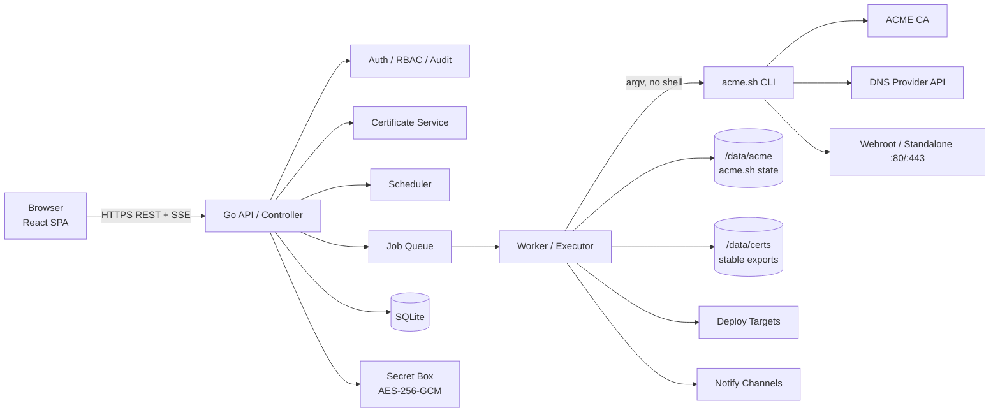
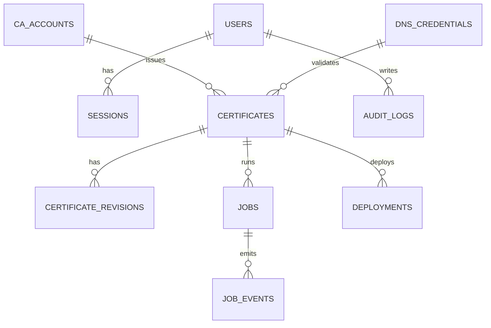
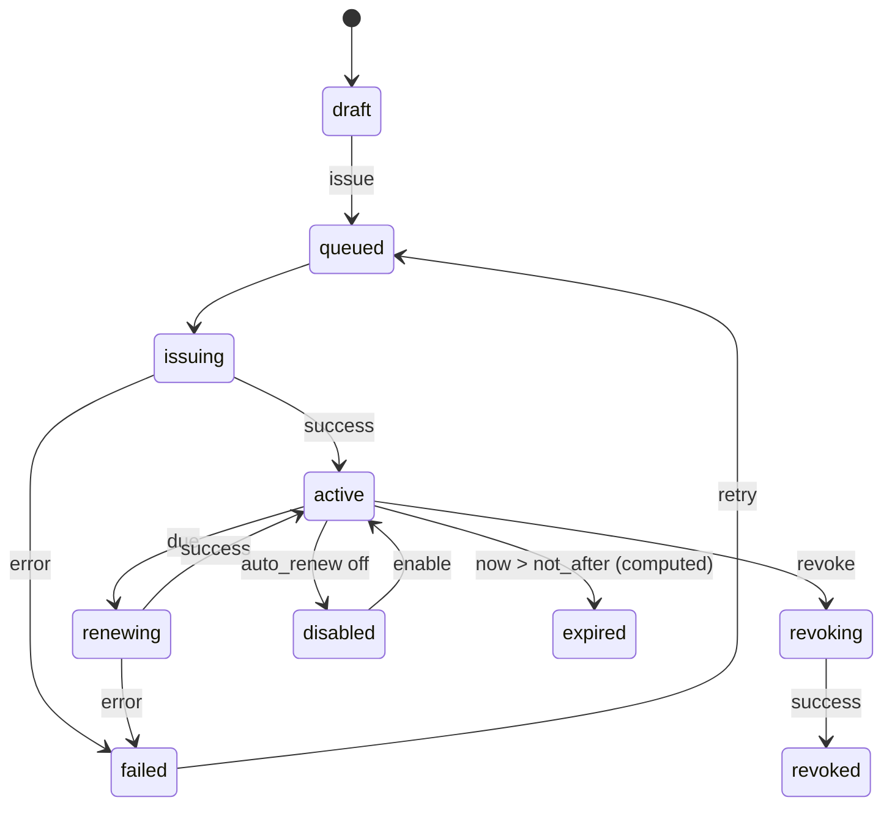
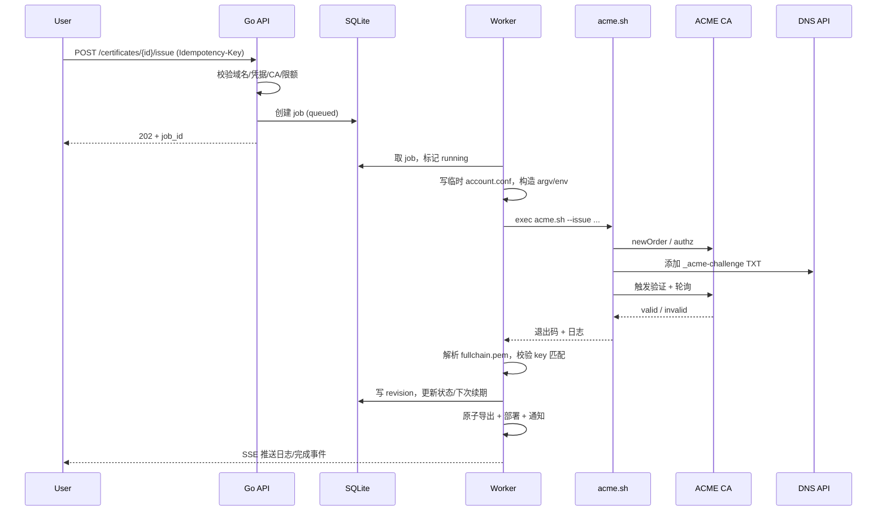

# KPCCSSL 技术方案分析

> 状态：设计草案 v0.1  
> 日期：2026-10-31  
> 目标：用 Go + React SPA 实现一个自托管的 Web 证书签发工具，ACME 引擎使用 [acme.sh](https://github.com/acmesh-official/acme.sh)。  

---

## 0. 结论摘要

**方案可行，推荐采用“Go 控制面 + acme.sh 执行面 + React SPA 静态嵌入”的单体架构。**

核心判断：

1. **acme.sh 适合当“黑盒 CLI 执行器”，不适合被改造成库。** 它真正的价值是约 200 个 DNS 服务商脚本和成熟的 ACME 流程；Go 侧不需要重复实现 ACME 协议。
2. **产品难点不在“签发成功”，而在凭据安全、并发状态、续期调度、失败恢复、证书分发和可观测性。** 这些必须由 Go 控制面负责，不能依赖 acme.sh 的 cron 和日志。
3. **MVP 建议先做 DNS-01 + 单机 Docker + 单管理员。** HTTP-01/webroot 作为第二优先级；远程 Agent、多租户、云负载均衡部署后置。
4. **绝对不要把 acme.sh 的 `--reloadcmd`、`--pre-hook`、`--post-hook` 原样暴露给 Web 用户。** 它们本质是任意 shell 执行，等于把 Web 漏洞升级为宿主机 RCE。用结构化“部署目标”替代。
5. **必须解决 acme.sh 的全局状态问题：串行执行、临时 `--accountconf`、固定版本、禁用自动升级。** 否则并发签发会互相覆盖凭据，自动升级会悄悄改变输出格式并破坏解析。

预估工作量（单人）：

- 可用的 MVP：**4～5 周**
- 达到可长期运行的生产质量：**8～10 周**
- 远程分发/多节点/云厂商集成：再增加 **4～6 周**

---

## 1. 背景与目标

### 1.1 产品定位

一个自托管的 Web 工具，用于：

- 管理 ACME 账户（Let's Encrypt、ZeroSSL、Google Public CA、SSL.com、Actalis，以及任意 RFC 8555 自定义 CA；预设从内置 acme.sh 的 CA 列表自动同步）；
- 为域名签发、续期、吊销证书；
- 支持 DNS-01（API 自动加 TXT）、HTTP-01（webroot/standalone）、TLS-ALPN-01；
- 展示证书状态、到期时间、签发历史、任务日志；
- 把证书部署到本机路径、Web 服务器、远程主机或 Webhook；
- 在到期前自动续期，并在失败时告警。

### 1.2 设计目标

| 目标 | 说明 |
|---|---|
| 安全 | 私钥和 DNS API 凭据加密存储；最小权限；无 shell 注入；完整审计 |
| 可运维 | 单二进制、单容器、健康检查、备份恢复、明确升级路径 |
| 可观测 | 每个任务有状态、超时、日志、错误码、重试记录 |
| 可恢复 | 进程重启后任务可对账；不重复下单；不丢证书 |
| 可扩展 | ACME 引擎、DNS 服务商、部署目标都做成可插拔接口 |

### 1.3 非目标（至少 MVP 不做）

- 公共 SaaS、多租户计费；
- 完整 PKI/内部 CA；
- 高可用集群（acme.sh 的状态模型不适合简单多副本）；
- 任意 shell 钩子；
- 自研 ACME 协议实现。

---

## 2. 现状核对（基于当前仓库与 acme.sh）

当前仓库 `AXmishell/KPCCSSL` 只有 `LICENSE` 和一个 Initial commit，**没有既有代码约束**，可以从零设计。

核对 acme.sh 当前版本后的关键事实：

| 事实 | 对设计的影响 |
|---|---|
| 纯 Shell 实现，依赖 `curl`/`wget`、`openssl`、可选 `socat`/`nc` | 运行镜像不能是 distroless，需要 shell 和这些工具 |
| `dnsapi/` 下约 200 个脚本（当前 202 个 `.sh`，含少量公共辅助脚本），覆盖大量 DNS 服务商 | 这是选 acme.sh 的核心理由；provider 和字段从 `dns_<id>_info` 块自动发现，常用 provider 用人工校准的元数据覆盖 |
| 默认 CA 是 **ZeroSSL**，不是 Let's Encrypt | 必须显式传 `--server`，不能依赖默认值；UI 要让用户明确选择 |
| 默认密钥类型 `ec-256`，默认续期天数 30 天 | 符合现代默认；但续期不能写死 30 天，要跟随 ARI 和实际 NotAfter |
| 支持 ARI（RFC 9773），`--renew` 会参考 CA 的 `suggestedWindow` | 续期调度应“每天触发、由 acme.sh 判断是否真的续”，而不是自己算死日期 |
| `--listraw` 可输出 `Main_Domain\|KeyLength\|SAN\|Profile\|CA\|Created\|Renew` | 可作为“实际状态”同步入口，避免解析自由文本日志 |
| `--install-cert` 支持 `--key-file`、`--fullchain-file`、`--cert-file`、`--ca-file`、`--reloadcmd` | 用稳定的导出路径，不要直接依赖 `~/.acme.sh/<domain>/` 内部布局（官方 README 明确警告） |
| 支持 `--accountconf <file>` | 可用于“每次任务使用临时账户配置”，避免 DNS 凭据写入主 `account.conf` |
| 许多 DNS 插件会把凭据以 `SAVED_*` 明文写入 `account.conf` | 这是重要的残留风险；必须用临时 accountconf + 文件权限 + 磁盘加密缓解 |
| acme.sh 本身没有看到全局进程锁 | 必须由 Go 侧串行化，至少同一 `config-home` 同时只跑一个 acme.sh |
| 支持 `--cert-profile`、`--valid-to`、`--preferred-chain`、`--challenge-alias`、`--dnssleep`、`--always-force-new-domain-key`、`--ocsp` | 高级选项可以逐步暴露，不必首版全做 |
| 支持 `--revoke --revoke-reason 0-10` | 吊销功能可直接实现 |
| 许可证是 **GPLv3**，本项目现同样采用 GPLv3 | 分发包含 acme.sh 的镜像时统一遵守 GPLv3（提供源码/声明） |

> 说明：以上行为基于当前 acme.sh master 代码核对。实现时应固定一个 tag，并针对该版本做契约测试，避免上游变更导致解析失效。

---

## 3. 需求分层

### 3.1 MVP（必须）

- 首次启动初始化管理员（一次性 setup token）。
- 登录/登出、会话、修改密码、基础审计。
- CA 账户管理：Let's Encrypt、ZeroSSL、自定义 ACME URL；Google/SSL.com 所需的 EAB 字段。
- DNS 凭据管理：从 acme.sh `dnsapi/` 自动同步 provider（含 Cloudflare、阿里云、腾讯云 DNSPod、AWS Route53 等），常用 provider 提供人工校准的字段标签与权限说明。
- 证书项目：主域名 + SAN、泛域名、密钥类型（ec-256/ec-384/rsa2048/rsa4096）、CA、验证方式。
- DNS-01 自动签发（含异步任务、实时日志、失败原因）。
- 证书列表/详情、到期时间、下载 PEM/ZIP。
- 自动续期：每日扫描、失败重试、告警。
- 吊销、手动强制续期。
- 通知：邮件 + Webhook（至少一种）。
- 本地部署：写文件到允许目录 + 可选 reload 命令模板。

### 3.2 v1（生产加固）

- HTTP-01 webroot、standalone（含端口映射方案）。
- TLS-ALPN-01。
- DNS alias/CNAME 委派。
- 证书版本历史、部署历史、回滚。
- PFX 导出、私钥下载二次确认。
- RBAC（admin/operator/viewer）、TOTP 2FA。
- 备份/恢复 CLI、`doctor` 自检。
- Prometheus 指标、结构化日志。
- 完整 i18n（中/英）和暗色主题。

### 3.3 后续

- Controller + Agent：向多台目标机分发证书。
- Kubernetes Secret、阿里云/腾讯云负载均衡/CDN 部署。
- OIDC/LDAP、多租户。
- 证书透明度（CT）监控、域名到期监控。
- 手工 DNS 两阶段签发（需要抓取并保存 challenge token）。

---

## 4. 总体架构



### 4.1 进程与部署拓扑

**模式 A：单容器（推荐 MVP）**

- 一个 Go 进程同时提供 API、SPA、调度器、任务 worker。
- `/data` 挂载卷：SQLite、master key、acme.sh home、证书导出、日志。
- 默认只暴露 8080（面板）；DNS-01 不需要 80/443。
- 需要 HTTP-01 standalone 时，容器内用非特权端口（如 8081），宿主机映射 `80:8081`，并给 acme.sh 传 `--httpport 8081`；TLS-ALPN 同理 `443:8443` + `--tlsport 8443`。这样可以避免容器内 root 绑定 80/443。

**模式 B：控制面 + 执行面分离（推荐演进）**

- `kpccssl serve`：只处理 HTTP/API，不执行 acme.sh，不持有 shell 权限。
- `kpccssl worker`：无入站端口，消费任务队列，执行 acme.sh。
- 两者共享数据库和 `/data`，用不同 Unix 用户运行。
- 好处：即使 API 被攻破，攻击者也不能直接以 worker 身份执行任意命令；但仍需防住任务参数注入。
- 代价：部署复杂一点；SQLite 需要同机共享卷，不能随意多副本。

**模式 C：Controller + Agent（后续）**

- 中央控制面把证书推送到多台目标机。
- Agent 只暴露 mTLS 接口，命令集固定：写入指定路径、重载指定服务、回报状态。
- 不建议用“SSH + 任意命令”作为长期方案；SSH 凭据本身也是高价值目标。

### 4.2 为什么不做微服务/多副本

- acme.sh 的状态在文件系统（`account.conf`、`ca/`、域名目录），天然是单写者模型。
- SQLite + 本地卷足够支撑数百张证书；这个规模不需要分布式系统。
- 若未来要 HA，正确路径是“控制面无状态化 + 执行面分片 + 每片独立 acme home”，而不是把同一个 home 挂到多个副本。

---

## 5. 技术选型

### 5.1 后端

| 领域 | 选择 | 理由 |
|---|---|---|
| 语言 | Go 1.24+（按 CI 稳定版固定） | 单二进制、并发、部署简单 |
| HTTP | 标准库 `net/http` + `chi`（或直接用 Go 1.22+ 路由） | 轻量，中间件生态够用 |
| 数据库 | SQLite（WAL）+ `modernc.org/sqlite` | 纯 Go、无 CGO、单文件备份；单机场景足够 |
| SQL | `sqlc` + `goose` 迁移 | 显式 SQL，避免 ORM 隐式行为；迁移可审计 |
| 日志 | `log/slog`（JSON） | 结构化、标准库 |
| 密码 | `golang.org/x/crypto/argon2` | Argon2id |
| 加密 | `crypto/aes` + GCM，信封加密 | 标准库，无外部依赖 |
| IDN | `golang.org/x/net/idna` | 域名规范化 |
| 公网后缀 | `golang.org/x/net/publicsuffix` | 速率限制按 eTLD+1 统计 |
| PKCS#12 | `software.sslmate.com/src/go-pkcs12` | 避免把 PFX 密码放到命令行 |
| 前端嵌入 | `embed.FS` | 单二进制交付 |
| 测试 | `testing` + `httptest` + `testify`（可选） | 标准 |
| 静态检查 | `golangci-lint`、`govulncheck`、`gosec` | CI |

### 5.2 前端

| 领域 | 选择 | 理由 |
|---|---|---|
| 框架 | React 19 + TypeScript | 生态成熟 |
| 构建 | Vite | 快，产物简单 |
| 路由 | React Router | SPA 常规方案 |
| 服务端状态 | TanStack Query | 缓存、重试、失效控制 |
| 表单 | React Hook Form + Zod | 动态 DNS 表单、校验 |
| UI | Tailwind CSS + shadcn/ui（Radix） | 可定制、无运行时锁定 |
| 国际化 | i18next | 中/英 |
| 图表 | Recharts（可选） | 到期分布 |
| 测试 | Vitest + Testing Library + Playwright | 单元 + E2E |
| API 类型 | OpenAPI 生成 `openapi-typescript` | 避免前后端字段漂移 |

### 5.3 构建与交付

- 多阶段 Docker：
  1. `node:22-alpine` 构建 `web/dist`；
  2. `golang:1.24-alpine` 把 `web/dist` 嵌入二进制；
  3. 运行时 `alpine:3.22`，安装 `bash curl openssl socat tzdata ca-certificates`，复制固定版本的 acme.sh 到 `/opt/acme.sh`。
- 运行用户：`kpccssl`（UID 10001），`/data` 0700。
- acme.sh 固定 tag + 校验和；**禁用自动升级**，升级走镜像版本。
- 提供 `docker-compose.yml`、systemd unit、健康检查、备份脚本。
- 发布产物：镜像 + SBOM + 校验和；可选 cosign 签名。

---

## 6. 关键设计

### 6.1 acme.sh 适配层（最重要的部分）

#### 6.1.1 调用契约

所有调用统一走一个 `Engine` 接口，底层用 `exec.CommandContext` 传 argv，**不经过 `sh -c`**。

典型签发命令：

```bash
/opt/acme.sh/acme.sh \
  --home /data/acme \
  --server letsencrypt \
  --issue \
  -d example.com -d '*.example.com' \
  --dns dns_cf \
  --keylength ec-256 \
  --accountconf /run/kpccssl/jobs/<job-id>/account.conf \
  --dnssleep 30 \
  --no-color
```

说明：

- `--home /data/acme`：状态、账户、域名配置都在持久卷；acme.sh 脚本和 `dnsapi/` 留在只读的 `/opt/acme.sh`，通过脚本自身路径查找插件。
- `--server` 必须显式传，避免 acme.sh 默认 ZeroSSL 带来的意外。
- `--accountconf` 指向临时文件，避免 DNS 凭据写入主 `account.conf`。
- `--dnssleep` 可按服务商配置；不要依赖默认值。
- `--no-color` 便于日志解析。
- 私钥和凭据**不要**放命令行参数，避免 `ps` 泄漏。

#### 6.1.2 临时 account.conf

acme.sh 的许多 DNS 插件会读取环境变量，也会把凭据以 `SAVED_<VAR>` 写回 `ACCOUNT_CONF_PATH`。因此：

1. 每个任务创建 `/run/kpccssl/jobs/<job-id>/`，权限 0700；
2. 写入临时 `account.conf`，至少包含 `ACCOUNT_EMAIL`，权限 0600；
3. 通过最小环境变量注入该任务的 provider 凭据；
4. 任务结束（成功/失败/超时）立即删除临时目录；
5. 启动时清理残留的任务目录；
6. 主 `/data/acme/account.conf` 保持 0600，且不应出现 `SAVED_*` 凭据。

注意：设置 `--accountconf` 后，acme.sh 不会自动加载默认 `account.conf`。因此临时文件必须包含该 CA/账户需要的配置（至少 `ACCOUNT_EMAIL`；如使用自定义 CA bundle、`HTTPS_INSECURE` 等也要显式带上）。这一点必须做集成测试，覆盖要支持的 DNS 插件。

账户注册（`--register-account`）建议使用主 `account.conf`（只含 `ACCOUNT_EMAIL`，不含凭据），或同样使用临时文件并每次显式传 `-m`；不要把 provider 凭据写进主文件。运行时也不要执行 acme.sh 的 `--install`，避免它把临时 `ACCOUNT_CONF_PATH` 写进主配置。

> 这是本方案中**最值得先做 PoC 验证**的一点。若某些插件不兼容，退路是：主 `account.conf` 0600 + 专用用户 + 卷加密 + 严格的日志脱敏，并接受凭据明文落盘的残余风险。

#### 6.1.3 并发与锁

- **全局锁**：同一个 `config-home` 同时只允许一个 acme.sh 进程。原因：`account.conf`、`ca/`、日志文件是共享的，且 acme.sh 没有内置进程锁。单进程内用 mutex；如果拆成 `serve`/`worker` 两个进程，必须用文件锁（`flock` `/data/acme/.lock`）或数据库锁，不能只靠进程内 mutex。
- **证书级锁**：同一张证书不允许并发的 issue/renew/revoke。
- **队列**：任务持久化到 SQLite，进程内 worker 消费；默认并发 1。签发通常 30 秒到 3 分钟，少量证书完全可接受。
- **扩展路径**：若要提高并发，不要简单调大并发数；应使用独立的 `config-home`/CA 账户做分片，并分别串行化。

#### 6.1.4 超时、取消与恢复

- 默认任务超时 20～30 分钟（DNS 传播可能很慢），可配置。
- 用 `Setpgid` 启动进程组；超时先 `SIGTERM`，宽限后 `SIGKILL` 整个进程组。
- acme.sh 没有优雅取消机制；强杀可能留下未清理的 `_acme-challenge` TXT 记录。UI 要提示这一点，并提供“重新签发/清理”指引。
- 进程启动时把所有 `running` 任务标记为 `interrupted`，再与 `--listraw`/证书文件对账，不要盲目重跑。

#### 6.1.5 状态同步

- **列表状态**：`acme.sh --listraw`（管道分隔），解析主域名、密钥类型、SAN、CA、创建时间、下次续期时间。
- **单证书详情**：优先用 Go 的 `crypto/x509` 解析导出的 `fullchain.pem`，得到 NotBefore/NotAfter、SAN、Issuer、Serial、SHA-256 指纹；不要解析 `openssl` 文本输出。
- **域名配置**：只读解析少量 `Le_*` 键（如 `Le_NextRenewTime`、`Le_API`、`Le_Keylength`），用受限的 `key=value` 解析器，绝不对 conf 执行 `source`。
- **原则**：数据库保存“期望配置”，acme.sh 文件保存“实际签发结果”；实际字段单向同步到数据库。不要直接编辑 acme.sh 的 conf。
- `--listraw` 只用于同步，不作为唯一真相；以证书文件的 x509 信息为准。

#### 6.1.6 退出码与错误分类

- `0`：成功。
- 非 `0`：失败；若使用 `--renew-all`，注意 `2` 可能表示“跳过”（acme.sh 提供 `--treat-skip-as-success`，但本方案建议逐证书 `--renew`，更易归因）。
- stdout/stderr 全量落盘（按任务一个日志文件），同时脱敏后推送 SSE。
- 维护一个**带版本号的错误模式表**，把常见日志映射为稳定错误码：

| 错误码 | 典型日志/场景 | 用户提示 |
|---|---|---|
| `E_DOMAIN_INVALID` | 域名格式、通配符位置错误 | 修正域名 |
| `E_DNS_AUTH` | 401/403、InvalidAccessKeyId、token 无效 | 检查 DNS 凭据 |
| `E_DNS_PROPAGATION` | Incorrect TXT record、Timeout | 检查 DNS 传播/权威 NS |
| `E_HTTP_CHALLENGE` | Invalid response、404、connection refused | 检查 80 端口/反代/webroot |
| `E_PORT_IN_USE` | Port 80 is already in use | 释放端口或改用 DNS-01 |
| `E_RATE_LIMIT` | rateLimited、too many certificates | 暂停并等待，检查限额 |
| `E_CA_REJECTED` | 订单/CSR/账户被拒 | 查看 CA 返回详情 |
| `E_NETWORK` | DNS/连接超时、TLS 错误 | 检查出站网络 |
| `E_TIMEOUT` | 任务超时 | 查看日志，必要时清理 DNS |
| `E_ACME_INTERNAL` | 未分类的 acme.sh 错误 | 展示原始日志 |
| `E_UNKNOWN` | 兜底 | 展示原始日志 |

#### 6.1.7 版本与升级

- 镜像内固定 acme.sh tag（例如 3.1.x），构建时校验 checksum。
- 启动时执行/确认自动升级关闭（`--upgrade --auto-upgrade 0` 或确保配置未开启）。
- 升级 acme.sh 必须伴随：契约测试（命令参数、`--listraw` 格式、错误模式、目标 DNS 插件）+ 回滚方案。
- 不要在生产容器里 `curl | sh`。

#### 6.1.8 Go 侧骨架

```go
type Spec struct {
    Command   string        // issue / renew / revoke / install-cert
    Domains   []string
    Server    string
    KeyType   string
    DNSPlugin string
    Webroot   string
    Timeout   time.Duration
    Env       []string      // provider credentials, minimal base env
    AccountConf string
}

type Executor struct {
    Bin  string
    Home string
    mu   sync.Mutex // 单进程内串行；多进程需再加 flock
}

func (e *Executor) Run(ctx context.Context, s Spec) (Result, error) {
    e.mu.Lock()
    defer e.mu.Unlock()

    ctx, cancel := context.WithTimeout(ctx, s.Timeout)
    defer cancel()

    cmd := exec.CommandContext(ctx, e.Bin, s.Args()...)
    cmd.Env = s.Env
    cmd.Dir = e.Home
    cmd.SysProcAttr = &syscall.SysProcAttr{Setpgid: true}
    // capture stdout/stderr to a job-scoped, size-limited writer
    // on timeout: kill -TERM process group, then -KILL
    return runAndCollect(cmd)
}
```

关键点：`Args()` 内部做参数白名单和值校验；绝不把用户输入拼进一个 shell 字符串。

---

### 6.2 数据模型

#### 6.2.1 核心实体



主要表：

| 表 | 关键字段 | 说明 |
|---|---|---|
| `users` | id, email, password_hash, totp_secret_enc, role, disabled, created_at | 单管理员也走这张表 |
| `sessions` | id, user_id, token_hash, csrf_secret, expires_at, ip, ua, last_seen_at | 只存 token 哈希 |
| `ca_accounts` | id, name, directory_url, email, eab_kid, eab_hmac_enc, status, created_at | EAB 加密 |
| `dns_credentials` | id, name, provider, config_enc, key_version, status, last_used_at | `config_enc` 是 AES-GCM 密文 |
| `certificates` | id, name, primary_domain, san_json, key_type, ca_account_id, challenge_type, dns_credential_id, webroot, options_json, auto_renew, status, current_revision_id, next_renew_at, version | 期望配置 + 当前状态 |
| `certificate_revisions` | id, certificate_id, serial, fingerprint_sha256, not_before, not_after, cert_path, key_path, chain_path, fullchain_path, issued_at, revoked_at | 每次签发一份，保留历史 |
| `jobs` | id, type, certificate_id, status, attempts, payload_json, idempotency_key, started_at, finished_at, error_code, error_message, log_path | 持久化队列 |
| `deployments` | id, certificate_id, type, config_enc, enabled, last_run_at, last_status | 部署目标 |
| `deployment_runs` | id, deployment_id, revision_id, status, message, created_at | 部署历史 |
| `notification_channels` | id, type, config_enc, events_json, enabled | 邮件/Webhook 等 |
| `audit_logs` | id, actor_id, action, resource_type, resource_id, ip, ua, detail_json, created_at | 追加写，不修改 |
| `settings` | key, value_enc, updated_at | 加密/非加密系统设置 |

#### 6.2.2 状态机



- `expired` 建议是**计算状态**，不单独持久化，避免时间驱动的不一致。
- `active` 表示“当前有一份有效证书”；是否即将过期由 `not_after` 计算。
- 失败必须保留最后一次成功的 revision，不能因为续期失败把可用证书标成失效。

#### 6.2.3 SQLite 实践

- `PRAGMA journal_mode=WAL; foreign_keys=ON; busy_timeout=5000; synchronous=NORMAL;`
- 时间统一 UTC 秒/毫秒整数；前端按用户时区显示。
- 单写者：SQLite 写事务短小；acme.sh 的长时间操作不要包在数据库事务里。
- 备份用 `VACUUM INTO` 或 `.backup`，不要直接复制正在写入的 db 文件。

---

### 6.3 签发流程



#### 6.3.1 前置校验（不要省）

- 域名规范化：小写、IDNA 转 ASCII、去掉尾点；长度 ≤253；label 1–63；不允许下划线；通配符只允许最左 `*.`；拒绝 `..`、空格、控制字符。
- 拒绝以 `-` 开头的域名，避免被 acme.sh 当作选项解析。
- 泛域名必须使用 DNS-01；强制在 UI 和 API 双重校验。
- CA 账户必须已注册；EAB 必填项齐全。
- DNS 凭据必须属于该证书可用的 provider；字段完整。
- webroot 必须是绝对路径，且在允许根目录下（`filepath.EvalSymlinks` 后校验），目录可写；禁止 `/`、`/etc`、`/proc` 等。
- 速率限制预检：按 eTLD+1 统计最近签发/失败次数，超限直接拒绝并提示等待。
- 可选：DNS 权威 NS 预检、HTTP challenge 可达性预检（服务端发请求只能作为提示，不能作为唯一判断）。

#### 6.3.2 验证方式对比

| 方式 | 泛域名 | 端口要求 | 适用场景 | MVP |
|---|---|---|---|---|
| DNS-01（API） | ✅ | 只需出站 443 | 首选；容器/内网/反代后都能用 | ✅ |
| DNS alias/CNAME | ✅ | 出站 443 | `_acme-challenge` 委派到统一 DNS 账户 | v1 |
| HTTP-01 webroot | ❌ | 80 可达，反代可服务 | 已有 Web 服务器、共享卷 | v1 |
| HTTP-01 standalone | ❌ | 80 空闲 | 没有现成 Web 服务器 | v1（高级） |
| TLS-ALPN-01 | ❌ | 443 空闲 | 不能占用 80 的场景 | v1（高级） |
| DNS 手工 | ✅ | 无 | 无 API 的 DNS | 后续；不能自动续期 |

**关键取舍：把 DNS-01 作为默认路径。** 它不依赖入站 80/443，最适合容器化部署，也支持泛域名。HTTP-01 在“面板和业务 Web 服务器同机/同反代”场景下体验更好，但网络前提更苛刻。

#### 6.3.3 DNS 服务商目录

acme.sh 的插件没有统一元数据，需要自建一个静态目录（嵌入二进制或 JSON）：

```json
{
  "id": "dns_cf",
  "name": "Cloudflare",
  "fields": [
    {"key": "CF_Token", "label": "API Token", "secret": true, "required": true},
    {"key": "CF_Account_ID", "label": "Account ID", "secret": false, "required": false},
    {"key": "CF_Zone_ID", "label": "Zone ID", "secret": false, "required": false}
  ],
  "wildcard": true,
  "notes": "Token 需要 Zone:DNS:Edit 权限"
}
```

实现建议：

- 先手工维护目标用户最常用的 5～8 家，不要一开始追求 200 家全支持。
- 启动时从 `dnsapi/` 自动发现 provider；字段仍通过 info 块生成的白名单校验，未知环境变量不能注入 acme.sh。
- 每个 provider 的字段映射到环境变量；前端根据 `secret` 决定密码框。
- 提供“测试凭据”功能：用 staging CA 对一个用户指定的测试域名做一次 DNS-01（可选，会产生真实 DNS 记录）；或者只做字段格式校验，首次签发时再暴露真实错误。两者要明确标注。
- 记录每个 provider 的限制：是否需要 zone ID、是否支持泛域名、是否有 propagation 延迟、是否需要 CNAME 委派。

#### 6.3.4 速率限制与防重复

- 按 eTLD+1 统计：签发次数、失败验证次数、重复证书次数。
- 阈值配置化，不写死 CA 的具体数字；默认保守。
- 重试使用指数退避：例如 1 分钟、10 分钟、1 小时、6 小时；超过次数转人工。
- 同一证书的 issue 请求用数据库唯一约束 + 证书锁去重；API 支持 `Idempotency-Key`，避免前端重试造成重复订单。
- staging 目录仅用于测试；部署时根据 directory_url 自动识别 staging/test 目录并给出警告，避免把测试证书用于生产。

---

### 6.4 续期调度

**推荐：Go 调度器每天随机时间触发一次“逐证书 `--renew` 扫描”，由 acme.sh 决定是否真的续期。**

理由：

- acme.sh 已经实现 ARI（RFC 9773）和 `Le_NextRenewTime` 判断；自己算日期容易漏掉 CA 提前要求续期的情况。
- 逐证书执行比 `--renew-all` 更容易归因、限流、重试和展示。
- 每天一次的成本很低（未到期时 acme.sh 会快速跳过）。

策略：

- 启动后错峰：在 0–30 分钟内随机延迟，避免所有实例同一时刻打 CA。
- 每个任务带 jitter；失败重试退避；连续失败告警。
- 手动“立即续期”使用 `--renew --force`；普通续期不要加 `--force`。
- 续期成功后：重新解析证书、写新 revision、原子切换 `current`、执行部署、发通知。
- 续期失败：保留旧证书；状态标记 `renew_failed`（或 `active` + 最后一次任务失败），继续重试；到期前持续告警。
- 证书寿命正在缩短（CA/B Forum 已确定分阶段降至 47 天），不要假设“永远 90 天、30 天续期”。`--days` 只作为可选项，默认让 acme.sh/ARI 决定。
- 支持“关闭自动续期”（`disabled`），用于迁移/下线前的过渡；关闭后仍显示到期告警。

可选增强：用 `--valid-to`/`--cert-profile` 支持 CA 的短周期 profile；UI 放在高级选项，默认不暴露。

---

### 6.5 证书产物与部署

#### 6.5.1 稳定导出路径

不要直接使用 `~/.acme.sh/<domain>/` 作为对外路径（官方 README 明确说内部结构可能变）。使用 `--install-cert` 导出到受控目录：

```
/data/certs/<cert-id>/
  revisions/<revision-id>/
    cert.pem
    privkey.pem
    chain.pem
    fullchain.pem
    meta.json
  current -> revisions/<revision-id>
```

流程：

1. `--issue`/`--renew` 成功后，调用 `--install-cert` 到临时 staging 目录；
2. Go 校验证书与私钥匹配（比较公钥）、解析 x509；
3. 把 staging 目录原子 rename 为 `revisions/<id>`；
4. 原子切换 `current` 符号链接；
5. 执行部署目标；
6. 失败则保留旧 `current`，记录部署失败。

`--install-cert` 不传 `--reloadcmd`，重载由 Go 的部署步骤控制；这样避免任意 shell，也便于回滚。

#### 6.5.2 导出格式

- PEM：`cert.pem`、`privkey.pem`、`chain.pem`、`fullchain.pem`。
- ZIP：上述文件 + `README.txt`（域名、到期时间、指纹）。
- PFX：用 Go 生成（密码由用户输入，不落日志/命令行）。
- JSON：元数据（不含私钥），供 API 集成。
- 私钥下载属于高敏感操作：默认需要重新确认密码/二次认证；全量审计。

#### 6.5.3 部署目标

| 类型 | 说明 | 风险控制 |
|---|---|---|
| 本地文件 | 复制到允许根目录下的路径 | 路径白名单、EvalSymlinks、原子写、备份 |
| 本机服务重载 | `nginx -s reload`、`systemctl reload nginx` | 只允许固定 argv 模板，不接受自由 shell |
| Webhook | POST 证书/元数据到外部 URL | HMAC 签名、超时、禁止内网地址（防 SSRF）、重试 |
| SSH/SFTP | 推送到远程主机并执行固定重载命令 | 主机密钥校验、密钥加密、命令白名单；后续再做 |
| Kubernetes/云 LB | 更新 Secret/证书 | 需要云凭据，权限最小化；后续再做 |

**不要**把 acme.sh 的 `--reloadcmd` 直接暴露给用户。若确实需要管理员自定义命令，放在“高级/危险”设置里，默认关闭，并要求重新认证 + 审计。

---

### 6.6 认证、授权与密钥管理

#### 6.6.1 首次启动

- 无用户时进入 `/setup`。
- 为防止公网抢注，启动时生成一次性 setup token，打印到容器日志（或要求环境变量 `KPCC_INITIAL_ADMIN_PASSWORD`）。
- setup 完成后关闭该入口。
- 强制管理员修改初始密码。

#### 6.6.2 会话与 CSRF

- 密码哈希：Argon2id（参数写入配置，随硬件调整）。
- 会话：随机 256-bit token，数据库只存 SHA-256；Cookie 使用 `__Host-` 前缀、`Secure`、`HttpOnly`、`SameSite=Lax`、`Path=/`。
- CSRF：SameSite + `Origin` 校验 + 双提交 token（或自定义请求头）；所有写操作都校验。
- 登录限流：按 IP + 账户，指数退避；失败审计。
- 可选 TOTP 2FA + 恢复码。
- 会话空闲/绝对超时；修改密码/权限后使旧会话失效。

#### 6.6.3 RBAC

| 角色 | 权限 |
|---|---|
| admin | 所有操作，含系统设置、凭据管理、私钥下载、用户管理 |
| operator | 签发/续期/吊销/部署，不能看凭据明文、不能改系统设置 |
| viewer | 只读列表/详情/日志（脱敏） |

凭据“可见但不可读”：API 只返回 `configured: true` 和掩码后四位；更新时整体替换，不返回旧值。

#### 6.6.4 主密钥与字段加密

- 主密钥 32 字节，来源优先级：`KPCC_MASTER_KEY_FILE` > `KPCC_MASTER_KEY` > 首次启动生成 `/data/master.key`（0600）。
- 字段加密：AES-256-GCM，随机 12 字节 nonce，AAD 绑定 `table:record_id:field`，密文格式 `v1:<base64(nonce||ciphertext||tag)>`。
- 每条记录带 `key_version`，支持主密钥轮换（重加密任务）。
- 主密钥**不要**和数据库备份放在一起；文档明确“丢失主密钥 = 加密凭据不可恢复”。
- 日志脱敏：`token`、`secret`、`key`、`password`、`authorization`、`cookie` 等键统一替换；禁止 `--output-insecure`。
- 进程禁止 core dump（部署层设置 `ulimit -c 0`），减少内存泄漏到磁盘。

#### 6.6.5 acme.sh 的凭据残留

这是必须正视的残余风险：

- acme.sh 的许多 DNS 插件会把 `SAVED_*` 凭据写入 `ACCOUNT_CONF_PATH`；
- 即使用临时 accountconf，崩溃/强杀也可能留下文件；
- 文件权限 0600 只能防其他用户，不能防 root/卷泄露。

缓解组合：

1. 临时 accountconf + 任务结束删除 + 启动清理；
2. `/data` 0700、专用用户、全盘/卷加密；
3. 不在日志中输出凭据；
4. 数据库加密只保护 DB 内的副本，不能替代卷加密；
5. 定期检查 `/data/acme/account.conf` 是否出现 `SAVED_` 并告警。

---

### 6.7 API 设计

REST + JSON，异步操作返回 `202 Accepted` + `job_id`。

| 方法 | 路径 | 说明 |
|---|---|---|
| POST | `/api/v1/setup` | 首次初始化（仅一次） |
| POST | `/api/v1/auth/login` | 登录 |
| POST | `/api/v1/auth/logout` | 登出 |
| GET | `/api/v1/me` | 当前用户 |
| GET/POST | `/api/v1/ca-accounts` | CA 账户列表/创建 |
| POST | `/api/v1/ca-accounts/{id}/register` | 注册/更新 ACME 账户 |
| GET/POST | `/api/v1/dns-credentials` | DNS 凭据 |
| GET | `/api/v1/dns-providers` | 静态 provider 目录 |
| GET/POST | `/api/v1/certificates` | 证书列表/创建 |
| GET/PATCH/DELETE | `/api/v1/certificates/{id}` | 详情/修改/删除（删除需确认） |
| POST | `/api/v1/certificates/{id}/issue` | 签发（幂等） |
| POST | `/api/v1/certificates/{id}/renew` | 续期（可强制） |
| POST | `/api/v1/certificates/{id}/revoke` | 吊销 |
| GET | `/api/v1/certificates/{id}/revisions` | 历史版本 |
| GET | `/api/v1/certificates/{id}/download?format=pem\|zip\|pfx` | 下载 |
| POST | `/api/v1/certificates/{id}/deploy` | 立即部署 |
| GET | `/api/v1/jobs/{id}` | 任务状态 |
| GET | `/api/v1/jobs/{id}/events` | SSE 实时日志 |
| GET | `/api/v1/audit-logs` | 审计 |
| GET | `/api/v1/settings` / PATCH | 系统设置 |
| GET | `/api/v1/system/health` | 健康 |
| GET | `/api/v1/system/info` | 版本、acme.sh 版本、磁盘 |

约定：

- 错误使用 `application/problem+json`：`{type, title, status, code, detail, request_id, fields}`。
- 列表分页：`limit` + `cursor`；默认 50，最大 200。
- 写操作支持 `Idempotency-Key`；证书更新用 `version` 做乐观锁。
- SSE 事件：`job.status`、`job.log`、`job.done`、`job.error`；支持 `Last-Event-ID` 断线重连。
- 日志按行推送，前端虚拟滚动；完整日志可下载。
- OpenAPI 3 文档 + 生成的 TS 类型；CI 检查 breaking change。

安全：

- 所有 `/api/v1/*` 除 login/setup/health 外都要求会话。
- 下载私钥、查看凭据、修改安全设置要求 admin + 二次确认。
- 对 `format=pfx` 的密码只走 POST body，不放在 URL/日志。
- 自定义 ACME URL 仅 admin 可配，并限制协议为 `https`（或明确允许内网测试 CA）。

---

### 6.8 前端页面

| 页面 | 核心内容 |
|---|---|
| 初始化 | setup token、管理员账户、默认 CA |
| 登录 | 密码、可选 TOTP、限流提示 |
| 仪表盘 | 证书总数、30 天内到期、续期失败、最近任务、CA 分布 |
| 证书列表 | 搜索、状态筛选、到期排序、自动续期开关、批量操作（后续） |
| 新建证书向导 | CA → 域名 → 验证方式 → DNS 凭据/Webroot → 高级 → 确认 → 进度 |
| 证书详情 | 状态、SAN、Issuer、有效期、指纹、当前 revision、历史时间线、下载、续期/吊销/部署 |
| 任务详情 | 实时日志、错误码、耗时、重试、原始日志下载 |
| DNS 凭据 | provider 选择、动态表单、掩码显示、测试 |
| CA 账户 | 注册状态、EAB 字段、目录 URL |
| 部署目标 | 类型选择、路径/命令模板、测试、历史 |
| 通知 | 渠道、事件订阅、测试发送 |
| 审计 | 时间、用户、动作、资源、IP、结果 |
| 系统 | 版本、acme.sh 版本、磁盘、健康检查、升级说明 |

交互要点：

- 向导每一步都做服务端校验，前端只做即时提示。
- 泛域名输入时明确提示“必须 DNS-01”。
- 手工 DNS 模式（后续）显示 TXT 记录、复制按钮、轮询状态。
- 任务日志默认自动滚动，提供“暂停滚动/复制/下载”；敏感值已脱敏。
- 私钥下载弹窗要求输入登录密码或 TOTP，并说明会记入审计。
- 空状态要给出下一步操作，不要只显示空白表格。
- 响应式 + 键盘可达 + 对比度；不在 localStorage 存 token/私钥。

---

### 6.9 通知、审计与可观测

**通知事件**：签发成功、续期成功、续期失败、即将到期、吊销、部署失败、任务卡住。

**渠道**：SMTP、通用 Webhook（HMAC 签名）、Telegram、Feishu/钉钉/企业微信、ntfy（按需）。

**通知可靠性**：

- 事件表 + 发送记录，失败重试（退避），去重（事件 ID）。
- Webhook 目标校验：HTTPS、超时、响应码、禁止内网地址（防 SSRF）。
- 测试按钮只发送测试消息，不触发真实签发。

**审计**：

- 记录：登录、失败登录、创建/修改/删除证书、签发、续期、吊销、下载私钥、查看/修改凭据、修改设置、部署。
- 字段：actor、action、resource、IP、UA、request_id、结果、时间。
- 追加写，不提供修改接口；保留期可配置；支持导出 CSV/JSON。

**指标**（可选 Prometheus）：

- `kpccssl_certificates_total{status}`
- `kpccssl_certificate_expiry_timestamp_seconds`（按证书，注意基数）
- `kpccssl_jobs_total{type,status}`
- `kpccssl_job_duration_seconds`
- `kpccssl_queue_depth`
- `kpccssl_renew_failures_total`

**日志**：JSON、request_id/job_id/user_id；按大小/天数轮转；默认保留 30 天；证书和凭据相关日志单独标记。

**健康检查**：

- `/healthz`：进程存活。
- `/readyz`：DB 可读、`/data` 可写、acme.sh 可执行、磁盘剩余空间、时钟偏移告警（可选）。
- `kpccssl doctor`：检查目录权限、acme.sh 版本、CA 连通性、DNS 插件存在性、端口占用。

### 6.10 备份、恢复与升级

**必须备份的内容**：

| 内容 | 路径 | 说明 |
|---|---|---|
| SQLite | `/data/kpccssl.db` | 用 `.backup`/`VACUUM INTO`，不要直接复制写入中的文件 |
| acme.sh 状态 | `/data/acme/` | 含 CA 账户私钥、`ca/`、域名配置；丢失后无法续期/吊销已有证书 |
| 证书导出 | `/data/certs/` | revision 不可变，可直接打包 |
| 主密钥 | `/data/master.key` 或外部密钥系统 | **必须与数据库备份分开存放** |
| 日志 | `/data/logs/` | 可选，按合规要求 |

**恢复顺序**：主密钥 → 数据库 → `/data/acme` → `/data/certs` → 启动并执行 `--listraw` 对账。恢复后先跑 `kpccssl doctor`，再手动续期一张测试证书。

**升级**：

- 数据库迁移只向前；升级前自动备份，失败可回滚镜像 + 数据库快照。
- acme.sh 与应用镜像同版本发布；升级前跑契约测试（参数、`--listraw`、目标 DNS 插件）。
- 不建议在运行中的容器里 `acme.sh --upgrade`；如必须，先备份 `/data/acme` 并记录版本。
- 提供 `kpccssl admin reset-password`、`kpccssl migrate`、`kpccssl doctor` 等运维子命令。

---

## 7. 安全威胁模型

| 威胁 | 影响 | 缓解 |
|---|---|---|
| Web 被攻破后通过证书参数执行 shell | 宿主机 RCE | 严格域名/路径校验；argv 调用；禁止自由 `reloadcmd`；控制面/执行面分用户 |
| DNS API 凭据泄露 | 域名被劫持/证书被冒签 | AES-GCM 加密；临时 accountconf；日志脱敏；卷加密；最小权限 token |
| 私钥泄露 | 中间人/冒充站点 | 0600；不入 webroot；下载需二次认证；审计；备份加密 |
| 面板被暴力破解/会话劫持 | 完全控制 | Argon2id；登录限流；HttpOnly/Secure/SameSite；CSRF；2FA；会话轮换 |
| 首次启动被公网抢注 | 攻击者成为管理员 | setup token/初始密码；未初始化时仅监听 localhost 或拒绝远程 |
| 路径穿越写入任意文件 | 覆盖系统文件 | webroot/部署路径白名单；EvalSymlinks；拒绝 `..`；原子写 |
| Webhook SSRF | 访问内网元数据/管理接口 | 禁止私有 IP/回环；DNS 重绑定防护；HTTPS；超时 |
| 自定义 ACME URL SSRF | 探测内网 | 仅 admin；HTTPS；可配置域名白名单 |
| 重复签发打爆 CA 限额 | 域名被限流，业务受损 | 幂等键；证书锁；eTLD+1 限额；staging 默认用于测试 |
| acme.sh 自动升级破坏解析 | 签发/续期静默失败 | 固定版本；禁用自动升级；契约测试；升级流程 |
| 日志包含 token | 凭据泄露 | 统一脱敏；禁止 `--output-insecure`；限制日志访问 |
| 备份被窃取 | 全部凭据/私钥泄露 | 备份加密；主密钥分离；最小访问 |
| 供应链（镜像/acme.sh/前端依赖） | 后门 | 固定版本+校验和；SBOM；依赖扫描；镜像签名 |

---

## 8. 风险登记

| 风险 | 概率 | 影响 | 对策 |
|---|---|---|---|
| 临时 `--accountconf` 对部分 DNS 插件不生效 | 中 | 凭据仍写入主配置 | 先做 3～5 个目标 provider 的 PoC；不兼容则退回主配置 + 卷加密 + 告警 |
| 并发 acme.sh 破坏共享状态 | 中 | 签发失败/状态错乱 | 全局串行；证级锁；不共享 home 做并发 |
| 80/443 端口冲突 | 高 | HTTP-01 失败 | DNS-01 默认；standalone 用 `--httpport/--tlsport` + 端口映射；文档写清 |
| acme.sh 输出/参数变化 | 中 | 解析失败 | 固定 tag；契约测试；错误模式版本化；保留原始日志 |
| CA 限额/策略变化 | 中 | 无法签发 | 限额配置化；staging；失败退避；告警 |
| 证书寿命缩短/ARI 变化 | 高 | 续期不及时 | 依赖 ARI + 实际 NotAfter；每日扫描；不要写死 30 天 |
| 面板自身证书鸡生蛋 | 中 | 无法安全访问 | 首次自签/反代终止；支持用本工具签发自身证书（DNS-01） |
| 私钥部署到远程主机 | 中 | 权限扩散 | Agent + 固定命令集；SSH 密钥加密；后续再做 |
| SQLite 单点/损坏 | 低 | 数据丢失 | WAL + 定期备份 + 恢复演练；不要多副本共享 |
| GPLv3 合规 | 低 | 法律风险 | 镜像附 acme.sh 源码/声明；不修改上游；法务确认 |

---

## 9. 备选方案对比

| 方案 | 优点 | 缺点 | 结论 |
|---|---|---|---|
| **acme.sh 子进程（本方案）** | 200 个 DNS provider；成熟；Go 侧简单 | Shell 依赖；全局状态；输出解析；GPLv3 | ✅ 采用 |
| Go 库 `lego` | 原生 Go、结构化 API、易测试、MIT | DNS provider 覆盖少一些；行为与 acme.sh 不同 | 保留为 `Issuer` 的第二实现，或用于面板自签 |
| certbot | 生态大 | Python 依赖重；插件模型不同 | 不采用 |
| 自研 ACME | 完全可控 | 工作量大、协议细节多 | 不采用 |

建议把 ACME 能力抽象成：

```go
type Issuer interface {
    Issue(ctx context.Context, spec IssueSpec) (IssueResult, error)
    Renew(ctx context.Context, spec RenewSpec) (IssueResult, error)
    Revoke(ctx context.Context, spec RevokeSpec) error
    List(ctx context.Context) ([]CertState, error)
}
```

MVP 只实现 `ACMEshIssuer`；测试用 `FakeIssuer`；未来可加 `LegoIssuer`，不影响上层。

---

## 10. 工程结构建议

```text
.
├── cmd/
│   └── kpccssl/
│       └── main.go              # serve / worker / migrate / doctor / admin
├── internal/
│   ├── api/                     # HTTP handlers, middleware, SSE
│   ├── auth/                    # password, session, csrf, rbac, totp
│   ├── acme/                    # engine interface, acme.sh executor, parser, error map
│   ├── dnsprovider/             # provider catalog + field validation
│   ├── certificate/             # domain validation, state machine, x509 parsing
│   ├── job/                     # queue, worker, retry, logs
│   ├── scheduler/               # renewal sweep, jitter
│   ├── deploy/                  # local file, reload templates, webhook
│   ├── notify/                  # email, webhook, telegram...
│   ├── secret/                  # AES-GCM, master key, rotation
│   ├── store/                   # sqlc queries, migrations
│   ├── config/                  # env/flags, paths
│   └── webui/                   # embed.FS + SPA fallback
├── web/
│   ├── src/
│   │   ├── pages/
│   │   ├── components/
│   │   ├── api/
│   │   └── i18n/
│   ├── index.html
│   └── vite.config.ts
├── docs/
│   ├── README.md                # 文档库索引
│   ├── guide/                   # 安装、配置、开发、CLI
│   ├── operations/              # 运行手册、安全说明
│   ├── contributing/            # CI 与发布
│   ├── reference/               # 许可证
│   ├── architecture.md          # 本文
│   ├── adr/                     # 关键决策记录
│   ├── poc/                     # 验证记录
│   └── openapi.yaml             # API 契约
├── deploy/
│   ├── Dockerfile
│   ├── docker-compose.yml
│   └── systemd/kpccssl.service
├── migrations/
├── Makefile
└── README.md
```

关键工程约定：

- `web/dist` 通过 `go:embed` 嵌入；开发时 Vite 代理到 Go。
- SPA fallback：静态文件存在则返回文件，否则返回 `index.html`；`/api/*` 不 fallback。
- 带 hash 的静态资源长缓存；`index.html` 不缓存。
- 后端所有外部输入都过校验层；acme.sh 参数由专门的 builder 生成，禁止 handler 直接拼参数。
- 每个 job 一个日志文件；SSE 从内存环形缓冲 + 文件 tail 读取。
- CI：`go test ./...`、`golangci-lint`、`govulncheck`、前端 `tsc`/`vitest`、Playwright（可选）、Docker build、Trivy。

---

## 11. 里程碑

### Phase 0：脚手架与契约验证（3～5 天）

- 仓库结构、CI、Docker 骨架、SQLite 迁移。
- 固定 acme.sh 版本；跑通 Pebble/真实 staging 的最小签发。
- 验证 `--accountconf` 临时凭据方案（Cloudflare/Aliyun/DNSPod 中至少 2 家）。
- 输出 ADR：执行器契约、密钥管理、部署模式。

### Phase 1：MVP（约 3 周）

- 初始化/登录/会话/审计。
- CA 账户、DNS 凭据（3～5 家）。
- 证书项目 + DNS-01 签发 + 异步任务 + SSE 日志。
- 证书列表/详情/下载、吊销、手动续期。
- 每日续期扫描 + 失败重试 + 邮件/Webhook 通知。
- Docker 单容器交付。

### Phase 2：生产加固（约 3 周）

- HTTP-01 webroot/standalone、TLS-ALPN。
- 本地部署目标 + 原子切换 + 回滚。
- 速率限制、幂等、状态对账、崩溃恢复。
- 2FA、RBAC、私钥下载二次确认。
- 备份/恢复、`doctor`、指标、日志轮转。
- Pebble 集成测试、Playwright E2E、安全扫描。

### Phase 3：扩展（4～6 周）

- Controller + Agent 多机分发。
- Kubernetes/云 LB/CDN 部署。
- 手工 DNS 两阶段、DNS alias。
- OIDC/LDAP、多租户。
- 证书/域名到期监控、CT 日志监控。

---

## 12. 验收标准

功能：

- [ ] 用 Cloudflare/Aliyun/DNSPod 任一 provider，在 staging 和 production 各成功签发一张单域名证书。
- [ ] 成功签发一张泛域名证书（DNS-01），SAN 正确。
- [ ] 到期前自动续期成功，UI 显示新的 NotAfter/revision。
- [ ] 续期失败时保留旧证书，状态/告警正确，重试有退避。
- [ ] 吊销成功，状态和审计正确。
- [ ] 下载的 PEM/ZIP 中证书与私钥匹配，链完整；PFX 可被 openssl 校验。
- [ ] 任务日志实时可见，失败有可读错误码和原始日志。
- [ ] 进程重启后，运行中任务被标记/对账，不重复下单。

安全：

- [ ] 数据库泄露但无主密钥时，无法还原 DNS 凭据/EAB。
- [ ] API 响应和日志中不出现明文凭据/私钥。
- [ ] 域名、webroot、部署路径的注入/穿越测试通过。
- [ ] 未初始化实例不能被远程抢注管理员。
- [ ] CSRF、会话固定、暴力破解、SSRF 的基础测试通过。
- [ ] acme.sh 并发调用被串行化；同一证书不会重复下单。

运维：

- [ ] `docker compose up` 后健康检查通过。
- [ ] 备份/恢复演练通过（含 acme home 和证书）。
- [ ] acme.sh 升级流程有文档和回滚方案。
- [ ] 磁盘满、权限错误、CA 不可达时有明确告警。

---

## 13. 需要确认的问题

1. **部署形态**：只管理本机证书，还是必须把证书分发到多台远程服务器/云负载均衡？这决定是否第一期就做 Agent。
2. **验证方式**：能否接受 DNS-01 作为默认/唯一方式？是否必须支持 80 端口的 HTTP-01？
3. **用户模型**：单管理员内网工具，还是多用户/团队/SaaS？这决定 RBAC、租户隔离和审计强度。
4. **证书范围**：只需要单域名/多域名/泛域名，还是还要 IP 证书、PFX/JKS、客户端证书？
5. **面板自身 HTTPS**：由现有 Nginx/Caddy 终止，还是希望本工具自己签发并续期面板证书？
6. **规模**：预计多少张证书、多少个域名、多少个 DNS 账户？这决定是否需要并发分片和多实例。
7. **许可证**：是否接受分发包含 GPLv3 acme.sh 的镜像？若不接受，需要改为运行时由用户自行安装/挂载 acme.sh。

---

## 附录 A：acme.sh 常用命令速查

```bash
# 注册账户（显式指定 CA；ZeroSSL 需要邮箱，Google/SSL.com 需要 EAB）
acme.sh --register-account -m admin@example.com --server letsencrypt \
  --home /data/acme

# 签发（DNS-01，泛域名）
acme.sh --issue --server letsencrypt --home /data/acme \
  -d example.com -d '*.example.com' \
  --dns dns_cf --keylength ec-256 --dnssleep 30 --no-color

# 续期（普通；由 acme.sh 判断是否到期/ARI）
acme.sh --renew --home /data/acme -d example.com --ecc --no-color

# 强制续期
acme.sh --renew --home /data/acme -d example.com --ecc --force --no-color

# 导出到稳定路径（不要直接用 ~/.acme.sh 内部文件）
acme.sh --install-cert --home /data/acme -d example.com --ecc \
  --key-file /data/certs/<id>/staging/privkey.pem \
  --fullchain-file /data/certs/<id>/staging/fullchain.pem \
  --cert-file /data/certs/<id>/staging/cert.pem \
  --ca-file /data/certs/<id>/staging/chain.pem

# 吊销
acme.sh --revoke --home /data/acme -d example.com --ecc --revoke-reason 1

# 查看状态
acme.sh --list --listraw --home /data/acme
acme.sh --info --home /data/acme -d example.com --ecc
```

## 附录 B：不建议暴露的 acme.sh 能力

- `--reloadcmd` / `--pre-hook` / `--post-hook` / `--renew-hook` / `--deploy-hook`：任意 shell。
- `--output-insecure`：会把敏感值打到日志。
- `--insecure`：关闭 TLS 校验，除非明确的自定义测试 CA。
- `--upgrade --auto-upgrade`：生产环境禁用。
- 直接编辑 `~/.acme.sh/<domain>/<domain>.conf`：容易与 acme.sh 状态冲突。
